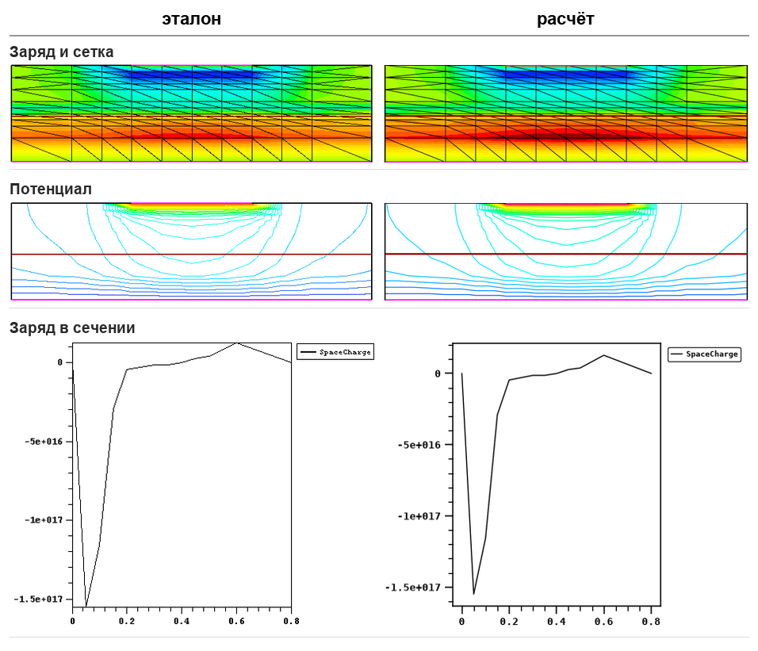
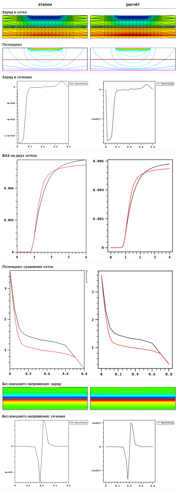
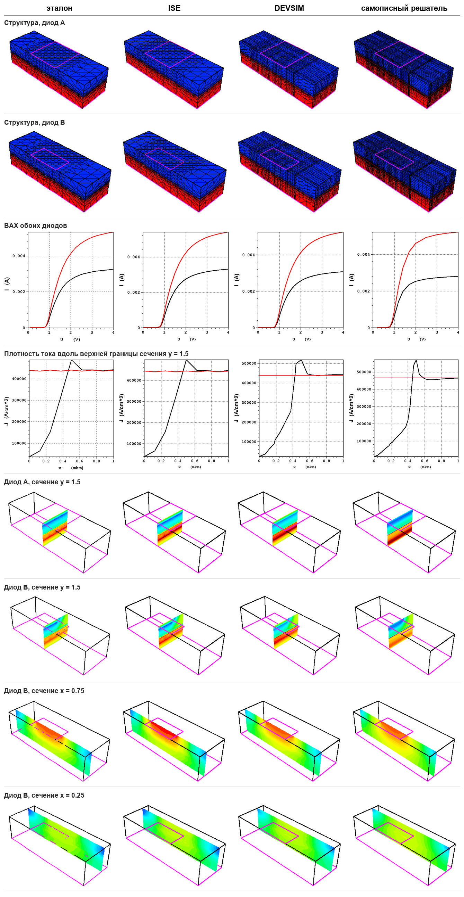

# Моделирование наноструктур — МИЭТ, 2026

- [Аннотация](#аннотация)
- [О работе](#о-работе)
- [Технические заметки](#технические-заметки)
- [Структура репозитория](#структура-репозитория)
- [Установка окружения](#установка-окружения)
- [Лабораторная 1. 2D диод с резким p-n переходом](#лабораторная-1-2d-диод-с-резким-p-n-переходом)
- [Лабораторная 2. Тот же диод на сетке вдвое мельче](#лабораторная-2-тот-же-диод-на-сетке-вдвое-мельче)
- [Лабораторная 3. 3D диод](#лабораторная-3-3d-диод)
- [Лабораторная 4](#лабораторная-4)
- [Лабораторная 5](#лабораторная-5)
- [Итоги](#итоги)
- [Ссылки](#ссылки)

## Аннотация

Лабораторные работы по курсу «Моделирование наноструктур», МИЭТ, 2026. В курсе
используется Sentaurus TCAD 2012, расчёты выполняются очно на компьютерах учебной
лаборатории. Здесь вместо него использован ISE TCAD 7.0 2001 года —
непосредственный предшественник Sentaurus: так работы остаются ближе к исходной
постановке, чем при переносе в COMSOL, которым пользуется большинство студентов
курса. Методические указания написаны для Sentaurus, и большая часть описанных
ниже трудностей связана именно с расхождениями между версиями пакета.

ISE работает только под Windows. Работы выполнены на MacBook с процессором M1:
ISE запущен в эмулированной Windows XP и управляется с хост-машины по telnet;
обработка результатов и визуализация — на Python. Результаты ISE дополнительно проверены
в DEVSIM и самописным решателем.

## О работе

Курс охватывает полный цикл приборного моделирования (TCAD): описание
структуры, построение сетки, решение уравнений дрейфа-диффузии и анализ полей и
ВАХ. Все работы выполнены по **варианту 2**. Результаты сравниваются с эталонами
из методических указаний; визуализация воспроизводит родной визуализатор ISE.

Сами пакеты ISE и Sentaurus и методические указания в репозиторий не входят; из
методических указаний приведены только эталонные иллюстрации варианта 2.

## Технические заметки

| | |
|---|---|
| [ISE TCAD 7.0 on Apple Silicon: Running a 2001 Semiconductor Package on a MacBook Air M1](notes/ise_tcad_apple_silicon.md) | запуск пакета 2001 года на M1: эмуляция XP, управление по telnet, ограничения при работе с путями и окнами, формат DF-ISE (рус. / англ.) |
| [Working with ISE TCAD: Mesh Refinement Rules, Reference-Matched Rendering and 3D Convergence](notes/ise_in_practice.md) | как генератор `mesh` на самом деле дробит сетку, калибровка визуализации по эталону, как сетка определила сходимость трёхмерного расчёта |
| [Validating DEVSIM Against ISE in 3D: Control-Volume Error, ISE Physics Port and Comparison with the Reference](notes/devsim_3d.md) | ошибка DEVSIM в объёмах ячеек в 3D и её поправка, перенос физических моделей ISE, проверка по ISE, сравнение с эталоном варианта 2 |
| [DEVSIM on a 2012 Workstation (FX-8320, TITAN X Pascal): MKL Pardiso False Convergence, cuDSS GPU Solver, FP64 and float128](notes/workstation_fx8320_titanx.md) | ложная сходимость MKL Pardiso, прямой решатель cuDSS на видеокарте, эмуляция FP64 на Pascal, точность float128 |
| [Charge Collection After Heavy-Ion Strikes: A Material Parameter Sweep in a 2001 TCAD Solver](notes/heavy_ion_charge_collection.md) | вне программы курса: развёртка параметров материала в ISE (рус. / англ.) |

## Структура репозитория

```
├── README.md
├── environment.yml               зависимости Python (conda)
├── notes/                        технические заметки
├── tools/                        обвязка: связь с XP, DF-ISE, отрисовка, решатели
│   └── guest/                    файлы, которые кладутся внутрь Windows XP
├── Lab1_diode_2D/                работа 1: блокнот, ise/ (файлы ISE), reference/, results/
├── Lab2_diode_2D_mesh/           работа 2, та же структура
├── Lab3_diode_3D/                работа 3
│   ├── make_figures.py           все иллюстрации и сводные листы одной командой
│   ├── ise/                      файлы ISE: командные, батники, срезы, результаты
│   ├── python/                   самописный 3D-решатель
│   ├── devsim/                   DEVSIM: run_ise.py — основной расчёт
│   ├── reference/                эталон методички
│   └── results/                  devsim_ise/, python/, ise/
└── experiments/                  вне курса: тяжёлые ионы, сетки, замеры на GPU
```

<details>
<summary>Что лежит в tools/</summary>

| | |
|---|---|
| [xp.py](tools/xp.py) | telnet-клиент к Windows XP: выполнение команд, получение файлов |
| [put.py](tools/put.py) | передача текстового файла в XP построчно |
| [dfise.py](tools/dfise.py) | чтение DF-ISE: сетка 2D и 3D, поля по регионам |
| [viz.py](tools/viz.py), [ise_style.py](tools/ise_style.py) | чтение `.plt`, отрисовка в стиле ISE |
| [ise3d.py](tools/ise3d.py) | 3D: структура прибора и срезы внутри каркаса |
| [compare.py](tools/compare.py), [sheet.py](tools/sheet.py) | сравнение с эталоном, сводные листы |
| [gen_variants.py](tools/gen_variants.py) | проекты ISE для всех 25 вариантов лаб 1–2 |
| [dd3d.py](tools/dd3d.py), [py3d_plots.py](tools/py3d_plots.py) | самописный 3D-решатель, визуализация его результатов и результатов DEVSIM |
| [dev_ise.py](tools/dev_ise.py), [ise_grid.py](tools/ise_grid.py), [voronoi3d.py](tools/voronoi3d.py), [tensor_mesh.py](tools/tensor_mesh.py) | DEVSIM с физикой и сеткой ISE |
| [dev3d.py](tools/dev3d.py), [mesh3d.py](tools/mesh3d.py) | DEVSIM на сетке Gmsh |
| [cudss_shim.py](tools/cudss_shim.py) | прямой решатель DEVSIM на видеокарте |
| [guest/](tools/guest/) | настройка X-сервера и picasso в гостевой XP |

</details>

## Установка окружения

```bash
conda env create -f environment.yml
conda activate nanomod
```

Иллюстрации работы 3 строятся без ISE командой `python Lab3_diode_3D/make_figures.py`.
Блокноты работ 1–2 обращаются к Windows XP; ячейки, которые только читают
выгруженные файлы из `ise/` и строят графики, выполняются и без неё. Для расчётов
в ISE требуются собственная копия пакета и виртуальная машина
([порядок установки](notes/ise_tcad_apple_silicon.md)); параметры доступа к гостевой
системе задаются переменными `XP_HOST`, `XP_USER`, `XP_PASSWORD`.

---

## Лабораторная 1. 2D диод с резким p-n переходом

Плоский кремниевый диод: сверху анод (не на всю ширину, поэтому ток
растекается), снизу катод во всю ширину, посередине резкий переход — сверху бор,
снизу мышьяк. На анод подаётся 4 В. Этапы соответствуют методическим указаниям: геометрия и легирование →
сетка → решение → визуализация.

**Вариант 2:** толщина диода d = 0.8 мкм, бор N<sub>B</sub> = 1.4·10¹⁷ см⁻³, мышьяк
N<sub>As</sub> = 1.0·10¹⁷ см⁻³. Базовая структура в методических указаниях рассчитана на d = 2 мкм,
поэтому всё вдоль Oy делится на k = 2/d = 2.5, а вдоль Ox не меняется.

Основные сложности: генератор строит сетку с шагом, отличным от заданного в
параметрах, а визуализация потребовала попиксельной калибровки по эталону. Обе
задачи разобраны в [заметке об ISE на практике](notes/ise_in_practice.md).



Сетка совпадает с эталонной поузлово. Ток при 4 В составляет 0.00580 А при
эталонном значении 0.00577 А (+0.5%).

<details>
<summary>Файлы работы</summary>

| | |
|---|---|
| [Lab1_diode_SDE.ipynb](Lab1_diode_2D/Lab1_diode_SDE.ipynb) | блокнот: весь путь от геометрии до картинок |
| [ise/sh1.bnd](Lab1_diode_2D/ise/sh1.bnd) | геометрия: кремний и два контакта |
| [ise/sh1.cmd](Lab1_diode_2D/ise/sh1.cmd) | сетка и легирование для `mesh` |
| [ise/sh1_des.cmd](Lab1_diode_2D/ise/sh1_des.cmd) | задание для `dessis`: физика, развёртка 0→4 В |
| [ise/cut.txt](Lab1_diode_2D/ise/cut.txt) | линия разреза для `dfisetools` |
| [ise/sh1_msh.grd](Lab1_diode_2D/ise/sh1_msh.grd), [sh1_msh.dat](Lab1_diode_2D/ise/sh1_msh.dat) | сетка и легирование |
| [ise/sh1_des.dat](Lab1_diode_2D/ise/sh1_des.dat), [sh1_des.plt](Lab1_diode_2D/ise/sh1_des.plt) | поля при 4 В и ВАХ |
| [ise/sh1_des_plt.plt](Lab1_diode_2D/ise/sh1_des_plt.plt) | распределения вдоль разреза |

</details>

## Лабораторная 2. Тот же диод на сетке вдвое мельче

Работа 1 повторяется на сетке с ячейками вдвое мельче для оценки зависимости
решения от сетки. Задание 4 — та же структура без внешнего напряжения.

**Вариант 2:** структура и легирование — как в работе 1 (d = 0.8 мкм,
N<sub>B</sub> = 1.4·10¹⁷ см⁻³, N<sub>As</sub> = 1.0·10¹⁷ см⁻³). Параметры сетки, мкм:

| | Mesh1 Max | Mesh1 Min | Mesh2 Max | Mesh2 Min |
|---|---|---|---|---|
| работа 1 | (0.5 0.2) | (0.1 0.05) | (0.25 0.1) | (0.05 0.025) |
| работа 2 | (0.5 0.1) | (0.1 0.025) | (0.125 0.1) | (0.025 0.0125) |

Шаг по Ox у Mesh1 и шаг по Oy у Mesh2 не меняются — так по эталону
([подробнее](notes/ise_in_practice.md#сетка-генератор-делит-пополам-пока-не-влезет)).



Ток при 4 В составляет 0.00548 А и совпадает с эталоном. На мелкой сетке он на
5% ниже, чем на крупной (0.00548 и 0.00580 А). Работы 1 и 2 приняты.

<details>
<summary>Файлы работы</summary>

| | |
|---|---|
| [Lab2_diode_MESH.ipynb](Lab2_diode_2D_mesh/Lab2_diode_MESH.ipynb) | блокнот |
| [ise/sh1.cmd](Lab2_diode_2D_mesh/ise/sh1.cmd) | сетка вдвое мельче |
| [ise/sh1_des.cmd](Lab2_diode_2D_mesh/ise/sh1_des.cmd), [sh1_des0.cmd](Lab2_diode_2D_mesh/ise/sh1_des0.cmd) | решатель: 4 В и 0 В (задание 4) |
| [ise/sh1_msh.grd](Lab2_diode_2D_mesh/ise/sh1_msh.grd), [sh1_des.dat](Lab2_diode_2D_mesh/ise/sh1_des.dat), [sh1_des.plt](Lab2_diode_2D_mesh/ise/sh1_des.plt), [sh1_des_plt.plt](Lab2_diode_2D_mesh/ise/sh1_des_plt.plt) | результаты при 4 В |
| [ise/v0_sh1_msh.grd](Lab2_diode_2D_mesh/ise/v0_sh1_msh.grd), [v0_sh1_des.dat](Lab2_diode_2D_mesh/ise/v0_sh1_des.dat), [v0_sh1_des_plt.plt](Lab2_diode_2D_mesh/ise/v0_sh1_des_plt.plt) | результаты при 0 В |

</details>

## Лабораторная 3. 3D диод

Параллелепипед кремния, переход посередине по высоте, анод сверху, катод — вся
нижняя грань. Два диода отличаются только анодом: у **A** он на всю ширину, у
**B** вдвое уже, и его край приходится на середину верхней грани. Задания:
структура обоих диодов, ВАХ, плотность тока вдоль верхней границы сечения
y = 1.5 мкм и заряд в трёх сечениях.

**Вариант 2:** 1 × 3 × 0.8 мкм (x × y × z), переход на z = 0.4 мкм,
N<sub>B</sub> = 1.4·10¹⁷ см⁻³ (сверху), N<sub>As</sub> = 1.0·10¹⁷ см⁻³ (снизу).
Анод A: x = 0…1, y = 1…2 мкм; анод B: x = 0.5…1, y = 1…2 мкм.

### Расчёт в ISE

О возможных проблемах со сходимостью в работе 3 предупреждали заранее. На первой
сетке (5751 узел, шаги примера по Oz разделены на 2.5) диод B не сошёлся ни при одной
настройке: линейные решатели `slip`, `super`, `pardiso`, `blocked`, пять схем
управления шагом, сгущение и огрубление сетки у анода, память виртуальной машины до
3 ГБ. Расчёт останавливался на 0.04–0.4 В или расходился в `1.#QNAN`.

Поэтому задача решена также в DEVSIM и самописным решателем на Python, с
физическими моделями ISE.

Оба диода в ISE сошлись только на сетке, построенной по эталонной иллюстрации
(1820 узлов, [ise/sA.cmd](Lab3_diode_3D/ise/sA.cmd)), с командным файлом из
примера методических указаний без изменений. На остальных опробованных сетках
расчёт диода B в ISE не сходится. Подбор сетки и перебор настроек — в
[заметке об ISE на практике](notes/ise_in_practice.md#3d-в-ise-решатель-сетка-и-ложные-признаки-успеха).

### Решатели

Командный файл у эталона и ISE один. Его физика перенесена в DEVSIM и самописный
решатель: подвижность Масетти, насыщение скорости Канали по модулю поля на элементе,
сужение запрещённой зоны OldSlotboom, без рекомбинации
([проверка по ISE](notes/devsim_3d.md#физические-модели-из-командного-файла-ise)).

| | сетка | узлов | метод | машина | время |
|---|---|---|---|---|---|
| эталон (Sentaurus TCAD 2012) | тетраэдры | ≈1800 | Ньютон | учебная лаборатория | нет данных |
| ISE 7.0 | тетраэдры, сетка эталона | 1820 | Ньютон, `slip` | M1, эмуляция XP | ≈25 с на точку, 10 мин на диод |
| DEVSIM 2.11 | тензорная, ячейка — 6 тетраэдров | 10 тыс. | Ньютон, UMFPACK | FX-8320 | ≈20 с на точку, 14 мин на диод |
| самописный | тензорная, прямоугольные ячейки | 76 тыс. | Гуммель + Андерсон, cuDSS | TITAN X Pascal | 17–90 с на точку, 11 мин на диод |

DEVSIM и самописный решатель считали по 2–4 прогона параллельно. Подробнее —
[DEVSIM](notes/devsim_3d.md), [рабочая станция](notes/workstation_fx8320_titanx.md).

### Результаты



Токи при 3.95 В:

| | узлов | диод A, мА | диод B, мА | B ниже A |
|---|---|---|---|---|
| эталон | ≈1800 | 5.30 | 3.25 | 38.7% |
| ISE | 1820 | 5.39 | 3.30 | 38.7% |
| DEVSIM | 10 тыс. | 5.24 | 3.07 | 41.4% |
| самописный | 76 тыс. | 5.21 | 2.80 | 46.3% |

ISE на сетке эталона совпадает с эталоном в пределах 2%. С измельчением сетки ток
диода B падает: сетка эталона по сетке не сошлась
([разбор](notes/devsim_3d.md#сравнение-с-эталоном-варианта-2)).

<details>
<summary>Файлы работы</summary>

| | |
|---|---|
| [make_figures.py](Lab3_diode_3D/make_figures.py) | все иллюстрации и сводные листы |
| [ise/sA.bnd](Lab3_diode_3D/ise/sA.bnd), [sB.bnd](Lab3_diode_3D/ise/sB.bnd), [sA.cmd](Lab3_diode_3D/ise/sA.cmd), [sB.cmd](Lab3_diode_3D/ise/sB.cmd) | геометрия, сетка и легирование |
| [ise/sA_des.cmd](Lab3_diode_3D/ise/sA_des.cmd), [sB_des.cmd](Lab3_diode_3D/ise/sB_des.cmd) | решатель ISE, как в примере методических указаний (`method=slip`) |
| [ise/runA.bat](Lab3_diode_3D/ise/runA.bat), [runB.bat](Lab3_diode_3D/ise/runB.bat) | прогон диода: сетка, решатель, срезы |
| [ise/cutAy.txt](Lab3_diode_3D/ise/cutAy.txt), [cutBy.txt](Lab3_diode_3D/ise/cutBy.txt), [cutBx75.txt](Lab3_diode_3D/ise/cutBx75.txt), [cutBx25.txt](Lab3_diode_3D/ise/cutBx25.txt), [topline.txt](Lab3_diode_3D/ise/topline.txt) | сечения и линия для `dfisetools` |
| [ise/sA_msh.grd](Lab3_diode_3D/ise/sA_msh.grd), [sA_msh.dat](Lab3_diode_3D/ise/sA_msh.dat), [sB_msh.grd](Lab3_diode_3D/ise/sB_msh.grd), [sB_msh.dat](Lab3_diode_3D/ise/sB_msh.dat) | 3D-сетки ISE |
| [ise/sA_des.plt](Lab3_diode_3D/ise/sA_des.plt), [sB_des.plt](Lab3_diode_3D/ise/sB_des.plt) | ВАХ ISE |
| [ise/sA_des.dat](Lab3_diode_3D/ise/sA_des.dat), [sB_des.dat](Lab3_diode_3D/ise/sB_des.dat) | трёхмерные поля ISE при 4 В (сечения строятся из них) |
| [ise/Ay.grd](Lab3_diode_3D/ise/Ay.grd), [By.grd](Lab3_diode_3D/ise/By.grd), [Bx75.grd](Lab3_diode_3D/ise/Bx75.grd), [Bx25.grd](Lab3_diode_3D/ise/Bx25.grd) (+ `.dat`), [AyTop.plt](Lab3_diode_3D/ise/AyTop.plt), [ByTop.plt](Lab3_diode_3D/ise/ByTop.plt) | срезы ISE |
| [devsim/run_ise.py](Lab3_diode_3D/devsim/run_ise.py), [tools/dev_ise.py](tools/dev_ise.py) | DEVSIM с физикой ISE — [запуск и разбор](notes/devsim_3d.md#файлы-и-запуск) |
| [devsim/iv_ise_A_tensor1_clip.json](Lab3_diode_3D/devsim/iv_ise_A_tensor1_clip.json), [iv_ise_B_tensor1_clip.json](Lab3_diode_3D/devsim/iv_ise_B_tensor1_clip.json) | ВАХ DEVSIM, тензорная сетка 10 тыс. |
| [devsim/field_ise_A_tensor1_clip.npz](Lab3_diode_3D/devsim/field_ise_A_tensor1_clip.npz), [field_ise_B_tensor1_clip.npz](Lab3_diode_3D/devsim/field_ise_B_tensor1_clip.npz) | поля DEVSIM при 4 В |
| [devsim/reference_iv.json](Lab3_diode_3D/devsim/reference_iv.json) | эталонная ВАХ, оцифрованная |
| [python/sweep_ise.py](Lab3_diode_3D/python/sweep_ise.py), [tools/dd3d_ise.py](tools/dd3d_ise.py) | самописный решатель: развёртка и сам решатель |
| [python/iv_ise_A_t2.npz](Lab3_diode_3D/python/iv_ise_A_t2.npz), [iv_ise_B_t2.npz](Lab3_diode_3D/python/iv_ise_B_t2.npz), [field_ise_A_t2.npz](Lab3_diode_3D/python/field_ise_A_t2.npz), [field_ise_B_t2.npz](Lab3_diode_3D/python/field_ise_B_t2.npz) | ВАХ и поля самописного решателя, 76 тыс. узлов |

</details>

## Лабораторная 4

В работе.

## Лабораторная 5

В работе.

## Итоги

Раздел будет заполнен по завершении всех работ.

## Ссылки

- [UTM issue #3723](https://github.com/utmapp/UTM/issues/3723) — Windows XP виснет на установке без PS/2
- [DEVSIM](https://devsim.org) — открытый TCAD-решатель на Python
- [Gmsh](https://gmsh.info) — генератор сеток
- Курсовой репозиторий аналогичной структуры: [Cluster_Computing_Course_MIPT_2021](https://github.com/alexlegoshin/Cluster_Computing_Course_MIPT_2021)
