# Моделирование наноструктур — МИЭТ, 2026

- [Коротко](#коротко)
- [Что это за работа](#что-это-за-работа)
- [Технические заметки](#технические-заметки)
- [Структура репозитория](#структура-репозитория)
- [Установка окружения](#установка-окружения)
- [Лабораторная 1. 2D диод с резким p-n переходом](#лабораторная-1-2d-диод-с-резким-p-n-переходом)
- [Лабораторная 2. Тот же диод на сетке вдвое мельче](#лабораторная-2-тот-же-диод-на-сетке-вдвое-мельче)
- [Лабораторная 3. 3D диод](#лабораторная-3-3d-диод)
- [Лабораторная 4](#лабораторная-4)
- [Лабораторная 5](#лабораторная-5)
- [Итоги](#итоги)
- [Ссылки](#ссылки)

## Коротко

Здесь мои лабы по моделированию наноструктур в МИЭТ. Считать их положено в
ISE TCAD 7.0 — пакете 2001 года, который живёт только под Windows. У меня
MacBook на M1, так что ISE работает внутри эмулированной Windows XP, а я
управляю им с мака по telnet и рисую всё на Python. Где ISE сдался, задача
досчитана своим решателем и в DEVSIM и сверена с тем, что ISE всё-таки посчитал.

## Что это за работа

Курс учит полному циклу приборного моделирования (TCAD): описать структуру,
построить сетку, решить уравнения дрейфа-диффузии и посмотреть на поля и ВАХ.
Все лабы — **вариант 2**. Картинки сравниваются с эталонами из методички, а
отрисовка подогнана под родной визуализатор ISE, чтобы сравнение было честным.

Самого ISE TCAD, его лицензий, мануалов и методичек кафедры здесь нет и не будет —
это чужое, и выкладывать его значит распространять. Здесь только своё: командные
файлы, обвязка на Python, выгруженные результаты и картинки. Из методички
оставлены только эталонные картинки варианта 2 — без них непонятно, с чем
сравнивать.

## Технические заметки

| | |
|---|---|
| [ISE TCAD 7.0 на Apple Silicon](notes/ise_tcad_apple_silicon.md) | как поднять пакет 2001 года на M1: эмуляция XP, telnet, грабли с путями и окнами, формат DF-ISE (рус. / англ.) |
| [ISE TCAD на практике](notes/ise_in_practice.md) | как генератор на самом деле строит сетку, отрисовка под эталон, почему 3D не досчитывался |
| [DEVSIM в 3D](notes/devsim_3d.md) | ошибка DEVSIM с ячейками в 3D, перенос физики ISE, эталон при 2 мкм, картинки из DEVSIM |
| [Рабочая станция FX-8320 + TITAN X](notes/workstation_fx8320_titanx.md) | MKL Pardiso, который врёт, прямой решатель на видеокарте, FP64 и float128 |
| [Сбор заряда после удара тяжёлого иона](notes/heavy_ion_charge_collection.md) | вне курса: что умеет стенд — развёртка материалов в ISE (рус. / англ.) |

## Структура репозитория

```
├── README.md
├── environment.yml               зависимости Python (conda)
├── notes/                        технические заметки
├── tools/                        обвязка: связь с XP, DF-ISE, отрисовка, решатели
│   └── guest/                    файлы, которые кладутся внутрь Windows XP
├── Lab1_diode_2D/                лаба 1: блокнот, ise/ (файлы ISE), reference/, results/
├── Lab2_diode_2D_mesh/           лаба 2, так же
├── Lab3_diode_3D/                лаба 3
│   ├── make_figures.py           все картинки и сводные листы одной командой
│   ├── ise/                      файлы ISE: командные, батники, срезы, результаты
│   ├── python/                   свой 3D-решатель
│   ├── devsim/                   DEVSIM: run_ise.py — основной расчёт
│   ├── reference/                эталон методички
│   └── results/                  devsim_ise/, python/, ise/
└── experiments/                  вне курса: тяжёлые ионы, сетки, замеры на GPU
```

<details>
<summary>Что лежит в tools/</summary>

| | |
|---|---|
| [xp.py](tools/xp.py) | telnet-клиент к Windows XP: выполнить команды, забрать файл |
| [put.py](tools/put.py) | залить текстовый файл внутрь XP построчно |
| [dfise.py](tools/dfise.py) | чтение DF-ISE: сетка 2D и 3D, поля по регионам |
| [viz.py](tools/viz.py), [ise_style.py](tools/ise_style.py) | чтение `.plt`, отрисовка в стиле ISE |
| [ise3d.py](tools/ise3d.py) | 3D: структура прибора и срезы внутри каркаса |
| [compare.py](tools/compare.py), [sheet.py](tools/sheet.py) | сравнение с эталоном, сводные листы |
| [gen_variants.py](tools/gen_variants.py) | проекты ISE для всех 25 вариантов лаб 1–2 |
| [dd3d.py](tools/dd3d.py), [py3d_plots.py](tools/py3d_plots.py) | свой 3D-решатель и картинки по нему и по DEVSIM |
| [dev_ise.py](tools/dev_ise.py), [ise_grid.py](tools/ise_grid.py), [voronoi3d.py](tools/voronoi3d.py), [tensor_mesh.py](tools/tensor_mesh.py) | DEVSIM с физикой и сеткой ISE |
| [dev3d.py](tools/dev3d.py), [mesh3d.py](tools/mesh3d.py) | DEVSIM на сетке Gmsh |
| [cudss_shim.py](tools/cudss_shim.py) | прямой решатель DEVSIM на видеокарте |
| [guest/](tools/guest/) | X-сервер и picasso внутри XP |

</details>

## Установка окружения

```bash
conda env create -f environment.yml
conda activate nanomod
```

Перерисовать лабу 3 без ISE — `python Lab3_diode_3D/make_figures.py`. Блокноты лаб
1–2 ходят в Windows XP; ячейки, которые только читают выгруженные файлы из
`ise/` и рисуют, работают и без неё. Для самого ISE нужна своя копия пакета и
виртуалка — [как её поднять](notes/ise_tcad_apple_silicon.md); доступ к гостю
задаётся переменными `XP_HOST`, `XP_USER`, `XP_PASSWORD`.

---

## Лабораторная 1. 2D диод с резким p-n переходом

Плоский кремниевый диод: сверху анод (не на всю ширину, поэтому ток
растекается), снизу катод во всю ширину, посередине резкий переход — сверху бор,
снизу мышьяк. На анод подаётся 4 В. Этапы как в методичке: геометрия и примесь →
сетка → решение → картинки.

**Вариант 2:** толщина диода d = 0.8 мкм, бор N<sub>B</sub> = 1.4·10¹⁷ см⁻³, мышьяк
N<sub>As</sub> = 1.0·10¹⁷ см⁻³. Базовая структура в методичке рассчитана на d = 2 мкм,
поэтому всё вдоль Oy делится на k = 2/d = 2.5, а вдоль Ox не меняется.

Трудности были две: генератор строит сетку не по тем размерам, что написаны в
параметрах, а картинки пришлось подгонять под эталон по пикселям — обе истории в
[заметке про ISE на практике](notes/ise_in_practice.md).

| эталон | наш расчёт |
|---|---|
|  |  |
|  |  |
|  |  |

Сетка совпала с эталонной узел в узел. Ток при 4 В — 0.00580 А против эталонных
0.00577 (+0.5%).

<details>
<summary>Файлы лабы</summary>

| | |
|---|---|
| [Lab1_diode_SDE.ipynb](Lab1_diode_2D/Lab1_diode_SDE.ipynb) | блокнот: весь путь от геометрии до картинок |
| [ise/sh1.bnd](Lab1_diode_2D/ise/sh1.bnd) | геометрия: кремний и два контакта |
| [ise/sh1.cmd](Lab1_diode_2D/ise/sh1.cmd) | сетка и легирование для `mesh` |
| [ise/sh1_des.cmd](Lab1_diode_2D/ise/sh1_des.cmd) | задание для `dessis`: физика, развёртка 0→4 В |
| [ise/cut.txt](Lab1_diode_2D/ise/cut.txt) | линия разреза для `dfisetools` |
| [ise/sh1_msh.grd](Lab1_diode_2D/ise/sh1_msh.grd), [sh1_msh.dat](Lab1_diode_2D/ise/sh1_msh.dat) | сетка и легирование |
| [ise/sh1_des.dat](Lab1_diode_2D/ise/sh1_des.dat), [sh1_des.plt](Lab1_diode_2D/ise/sh1_des.plt) | поля при 4 В и ВАХ |
| [ise/sh1_des_plt.plt](Lab1_diode_2D/ise/sh1_des_plt.plt) | распределения вдоль разреза |

</details>

## Лабораторная 2. Тот же диод на сетке вдвое мельче

Повторяем работу 1, уменьшив ячейки вдвое, и сравниваем: решение зависит от
сетки. Плюс задание 4 — та же структура без внешнего напряжения.

**Вариант 2** — тот же, что в лабе 1. Мельче становится не всё подряд: задание
требует уменьшить ячейки вдоль Oy, и по эталону видно, что краевые ячейки по Ox
остаются прежними, а шаг окна у анода по Oy не меняется
([подробнее](notes/ise_in_practice.md#сетка-генератор-делит-пополам-пока-не-влезет)).

| эталон | наш расчёт |
|---|---|
|  |  |
|  |  |
|  |  |
|  |  |
|  |  |
|  |  |
|  |  |

Ток при 4 В — 0.00548 А, ровно как в эталоне. На мелкой сетке он на 5% ниже, чем
на крупной (0.00548 против 0.00580). Лабы 1 и 2 сданы.

<details>
<summary>Файлы лабы</summary>

| | |
|---|---|
| [Lab2_diode_MESH.ipynb](Lab2_diode_2D_mesh/Lab2_diode_MESH.ipynb) | блокнот |
| [ise/sh1.cmd](Lab2_diode_2D_mesh/ise/sh1.cmd) | сетка вдвое мельче |
| [ise/sh1_des.cmd](Lab2_diode_2D_mesh/ise/sh1_des.cmd), [sh1_des0.cmd](Lab2_diode_2D_mesh/ise/sh1_des0.cmd) | решатель: 4 В и 0 В (задание 4) |
| [ise/sh1_msh.grd](Lab2_diode_2D_mesh/ise/sh1_msh.grd), [sh1_des.dat](Lab2_diode_2D_mesh/ise/sh1_des.dat), [sh1_des.plt](Lab2_diode_2D_mesh/ise/sh1_des.plt), [sh1_des_plt.plt](Lab2_diode_2D_mesh/ise/sh1_des_plt.plt) | результаты при 4 В |
| [ise/v0_sh1_msh.grd](Lab2_diode_2D_mesh/ise/v0_sh1_msh.grd), [v0_sh1_des.dat](Lab2_diode_2D_mesh/ise/v0_sh1_des.dat), [v0_sh1_des_plt.plt](Lab2_diode_2D_mesh/ise/v0_sh1_des_plt.plt) | результаты при 0 В |

</details>

## Лабораторная 3. 3D диод

Параллелепипед кремния, переход посередине по высоте, анод сверху, катод — вся
нижняя грань. Два диода отличаются только анодом: у **A** он на всю ширину, у
**B** вдвое уже, и его край приходится на середину верхней грани. Задания:
структура обоих диодов, ВАХ, плотность тока вдоль верхней границы сечения
y = 1.5 мкм и заряд в трёх сечениях.

**Вариант 2:** 1 × 3 × 0.8 мкм, те же N<sub>B</sub> и N<sub>As</sub>, что в лабах 1–2.
Анод A — x от 0 до 1, y от 1 до 2 мкм; анод B — x от 0.5 до 1.

ISE досчитал только диод A. Диод B посчитан в DEVSIM — открытом решателе, куда
перенесены физика и сетка ISE; для проверки есть ещё свой решатель на Python.
Часть расчётов шла на домашнем ПК — [заметка про рабочую станцию](notes/workstation_fx8320_titanx.md).

### Результаты

| | эталон | ISE | свой решатель | DEVSIM |
|---|---|---|---|---|
| структура A | 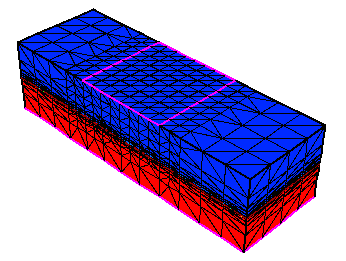 | 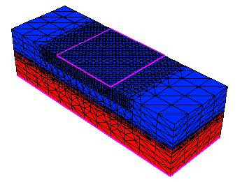 | — | 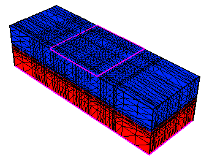 |
| структура B | 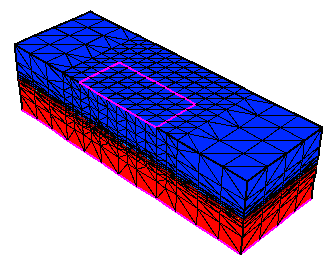 |  | — | 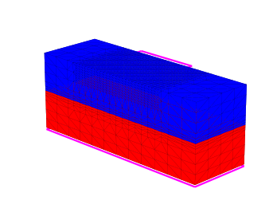 |
| ВАХ | 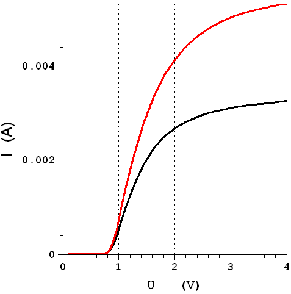 | 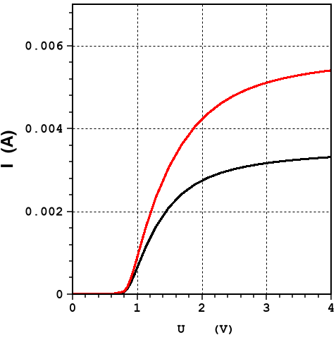 | 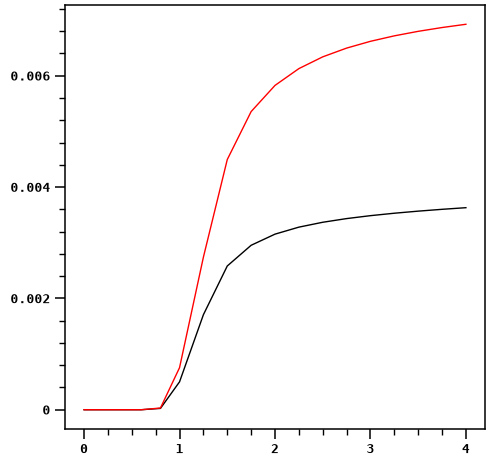 | 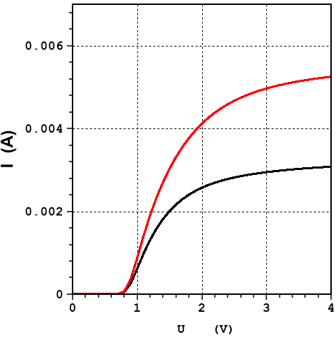 |
| ток вдоль границы | 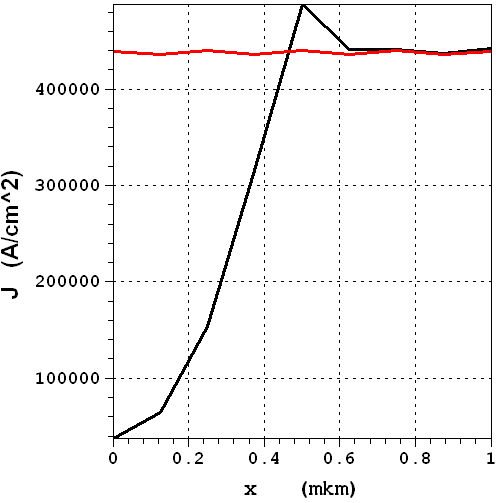 | — | 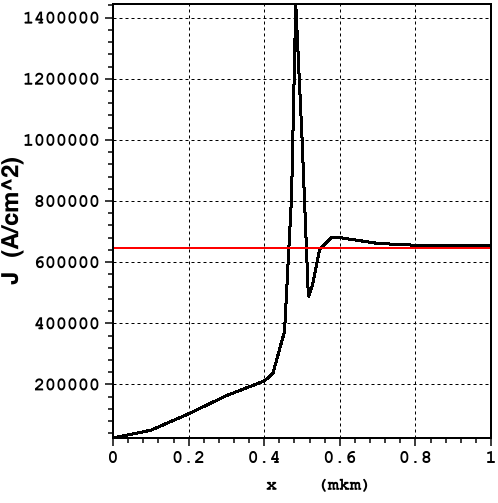 | 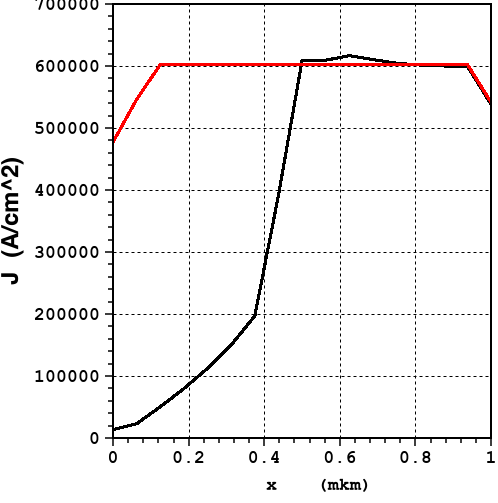 |
| A, сечение y = 1.5 | 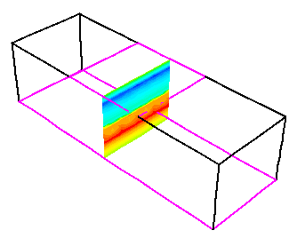 | 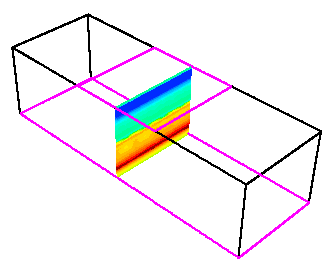 | 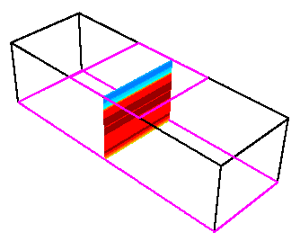 | 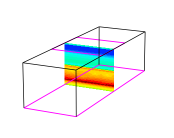 |
| B, сечение y = 1.5 | 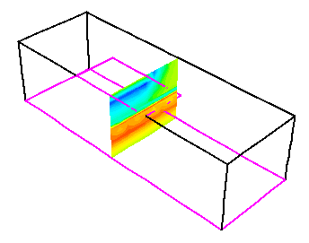 | — | 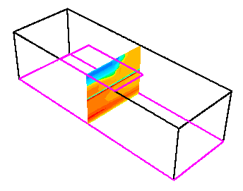 | 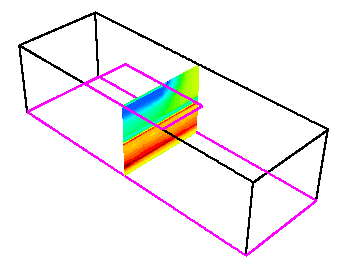 |
| B, сечение x = 0.75 | 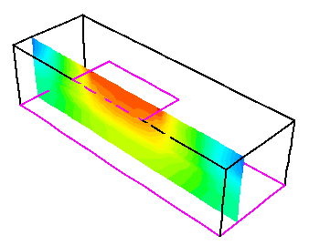 | — | 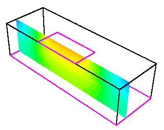 | 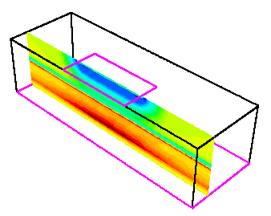 |
| B, сечение x = 0.25 | 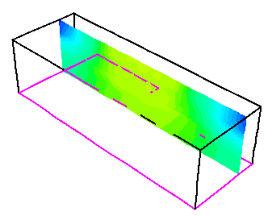 | — | 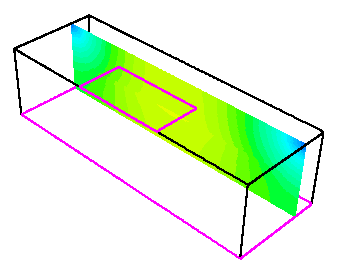 | 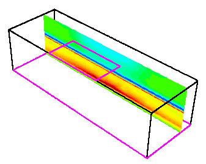 |

В ISE есть только диод A, поэтому на его ВАХ одна кривая. Свой решатель считает
на тензорной сетке, и картинок структуры у него нет. Каждый столбец целиком — на
сводных листах: [DEVSIM](Lab3_diode_3D/results/devsim_ise/СВОДНЫЙ_ЛИСТ.png),
[свой решатель](Lab3_diode_3D/results/python/СВОДНЫЙ_ЛИСТ.png),
[ISE](Lab3_diode_3D/results/ise/СВОДНЫЙ_ЛИСТ.png).

### Верификация


- **DEVSIM против ISE** (слева, 0.8 мкм, диод A): расхождение 1–2% на 1.5–4 В и
  0.04% на малых токах. Значит, физика и сетка перенесены правильно, и диоду B
  в DEVSIM можно верить.
- **DEVSIM против эталона** (справа): совпадение в пределах 1–3% на 2–4 В
  получается только при толщине 2 мкм — базовой структуре методички. Похоже,
  эталон в варианте 2 посчитан для неё, а не для 0.8 мкм
  ([разбор](notes/devsim_3d.md#эталон-посчитан-при-толщине-2-мкм)).
- **Сходимость по сетке:** на тензорной сетке 20 тыс. узлов ток отличается
  от сетки ISE меньше чем на 0.5%.
- **Воспроизводимость:** на маке и на ПК ВАХ совпали до 10⁻¹⁵.
- **Свой решатель** даёт на 33% больше ISE на полке: в нём проще физика (другие
  модели подвижности и насыщения, нет сужения запрещённой зоны). Для формы картин
  этого хватает, для цифр — нет.

### Итоги

Токи при 3.95 В:

| | диод A, мА | диод B, мА | B ниже A |
|---|---|---|---|
| эталон методички | 5.30 | 3.25 | 38.7% |
| DEVSIM, 2 мкм | 5.44 | 3.14 | 42.2% |
| **DEVSIM, 0.8 мкм (вариант 2)** | **5.29** | **2.88** | **45.5%** |
| ISE, 0.8 мкм | 5.19 | — | — |
| свой решатель, 0.8 мкм | 6.91 | 3.62 | 47.6% |

Анод B вдвое меньше по площади, а ток у него меньше только в 1.8 раза: плотность
тока под узким анодом выше, потому что ток растекается в сторону и стягивается к
свободному краю анода. Это видно на графике плотности тока — у B острый пик на
краю x = 0.5, у A ток ровный. При толщине 0.8 мкм ВАХ выходит на полку раньше,
чем при 2 мкм: прибор короче, и последовательное сопротивление вместе с
насыщением скорости ограничивают ток уже к 2 В.

### Почему не получилось в ISE

1. Командный файл был собран по шаблону лаб 1–2, без выбора линейного решателя.
   Решатель по умолчанию (`Blocked`) рассчитан на задачи с несколькими
   приборами; с `method=slip`, как требует мануал для одного прибора больше чем
   на 8000 узлов, диод A сошёлся до 4 В.
2. Диод B не сошёлся ни при одной настройке: четыре линейных решателя, пять схем
   управления шагом, огрубление сетки у анода, память виртуалки до 3 ГБ. Расчёт
   останавливался на 0.04–0.4 В, иногда расходясь в `1.#QNAN`.
3. Вероятная причина — особенность поля на краю анода B, который лежит на
   середине грани, при сжатой в 2.5 раза по высоте сетке варианта 2 (у
   преподавателя B считался при 2 мкм).

Поэтому диод B досчитан в DEVSIM на той же сетке и с той же физикой. Подробности —
в [заметке про ISE на практике](notes/ise_in_practice.md#3d-в-ise-решатель-память-и-ложные-успехи).

<details>
<summary>Файлы лабы</summary>

| | |
|---|---|
| [make_figures.py](Lab3_diode_3D/make_figures.py) | все картинки и сводные листы |
| [ise/sA.bnd](Lab3_diode_3D/ise/sA.bnd), [sB.bnd](Lab3_diode_3D/ise/sB.bnd), [sA.cmd](Lab3_diode_3D/ise/sA.cmd), [sB.cmd](Lab3_diode_3D/ise/sB.cmd) | геометрия, сетка и легирование |
| [ise/sA_des.cmd](Lab3_diode_3D/ise/sA_des.cmd), [sB_des.cmd](Lab3_diode_3D/ise/sB_des.cmd) | решатель ISE, `method=slip` |
| [ise/runAll.bat](Lab3_diode_3D/ise/runAll.bat), [cuts.bat](Lab3_diode_3D/ise/cuts.bat) | весь прогон / только срезы |
| [ise/cutAy.txt](Lab3_diode_3D/ise/cutAy.txt), [cutBy.txt](Lab3_diode_3D/ise/cutBy.txt), [cutBx75.txt](Lab3_diode_3D/ise/cutBx75.txt), [cutBx25.txt](Lab3_diode_3D/ise/cutBx25.txt), [topline.txt](Lab3_diode_3D/ise/topline.txt) | сечения и линия для `dfisetools` |
| [ise/sA_msh.grd](Lab3_diode_3D/ise/sA_msh.grd), [sA_msh.dat](Lab3_diode_3D/ise/sA_msh.dat), [sB_msh.grd](Lab3_diode_3D/ise/sB_msh.grd), [sB_msh.dat](Lab3_diode_3D/ise/sB_msh.dat) | 3D-сетки ISE |
| [ise/sA_des.plt](Lab3_diode_3D/ise/sA_des.plt), [sB_des.plt](Lab3_diode_3D/ise/sB_des.plt) | ВАХ ISE |
| [ise/Ay.grd](Lab3_diode_3D/ise/Ay.grd), [By.grd](Lab3_diode_3D/ise/By.grd), [Bx75.grd](Lab3_diode_3D/ise/Bx75.grd), [Bx25.grd](Lab3_diode_3D/ise/Bx25.grd) (+ `.dat`), [AyTop.plt](Lab3_diode_3D/ise/AyTop.plt), [ByTop.plt](Lab3_diode_3D/ise/ByTop.plt) | срезы ISE |
| [devsim/run_ise.py](Lab3_diode_3D/devsim/run_ise.py), [tools/dev_ise.py](tools/dev_ise.py) | DEVSIM с физикой ISE — [запуск и разбор](notes/devsim_3d.md#файлы-и-запуск) |
| [devsim/iv_ise_A_isemesh_clip.json](Lab3_diode_3D/devsim/iv_ise_A_isemesh_clip.json), [iv_ise_B_isemeshA_clip.json](Lab3_diode_3D/devsim/iv_ise_B_isemeshA_clip.json) | ВАХ DEVSIM, 0.8 мкм |
| [devsim/iv_ise_A_isemesh_lz2_clip.json](Lab3_diode_3D/devsim/iv_ise_A_isemesh_lz2_clip.json), [iv_ise_B_isemeshA_lz2_clip.json](Lab3_diode_3D/devsim/iv_ise_B_isemeshA_lz2_clip.json) | ВАХ DEVSIM, 2 мкм |
| [devsim/field_ise_A_isemesh_clip.npz](Lab3_diode_3D/devsim/field_ise_A_isemesh_clip.npz), [field_ise_B_isemeshA_clip.npz](Lab3_diode_3D/devsim/field_ise_B_isemeshA_clip.npz) | поля DEVSIM при 4 В |
| [devsim/reference_iv.json](Lab3_diode_3D/devsim/reference_iv.json) | эталонная ВАХ, оцифрованная |
| [python/sweep.py](Lab3_diode_3D/python/sweep.py), [tools/dd3d.py](tools/dd3d.py) | свой решатель: развёртка и сам решатель |
| [python/iv_A.npz](Lab3_diode_3D/python/iv_A.npz), [iv_B.npz](Lab3_diode_3D/python/iv_B.npz), [field_A.npz](Lab3_diode_3D/python/field_A.npz), [field_B.npz](Lab3_diode_3D/python/field_B.npz) | ВАХ и поля своего решателя |

</details>

## Лабораторная 4

Пока не сделана.

## Лабораторная 5

Пока не сделана.

## Итоги

Пока пусто.

## Ссылки

- [UTM issue #3723](https://github.com/utmapp/UTM/issues/3723) — Windows XP виснет на установке без PS/2
- [DEVSIM](https://devsim.org) — открытый TCAD-решатель на Python
- [Gmsh](https://gmsh.info) — генератор сеток
- Соседний курсовой репозиторий в том же духе: [Cluster_Computing_Course_MIPT_2021](https://github.com/alexlegoshin/Cluster_Computing_Course_MIPT_2021)
