# Моделирование наноструктур — МИЭТ, 2026

Лабораторные работы курса «Моделирование наноструктур» (МИЭТ, осень 2026),
**вариант 2**. Приборы считаются в **ISE TCAD 7.0** — пакете 2001 года, прямом
предке нынешнего Synopsys Sentaurus. Пакет работает внутри Windows XP, которая
эмулируется на **MacBook Air M1**, а всё управление, разбор результатов и
картинки — на Python на стороне мака.

Где ISE не справился (лаба 3, второй диод), задача досчитана своим трёхмерным
дрейф-диффузионным решателем на Python, а результат ISE использован для его
проверки.

> **Чего в репозитории нет и не будет.** Самого ISE TCAD, его лицензий,
> мануалов, образа Windows XP и методичек кафедры. Всё это чужая
> интеллектуальная собственность, и выкладывать её — значит распространять.
> Здесь лежит только своё: командные файлы к ISE, обвязка на Python,
> выгруженные из ISE результаты расчётов и картинки. Эталонные картинки из
> методички оставлены только для варианта 2 — без них не видно, с чем
> сравнивается результат.

---

## Содержание

- [Структура репозитория](#структура-репозитория)
- [С чего начать](#с-чего-начать)
- [Лабораторная 1. 2D диод](#лабораторная-1-2d-диод-с-резким-p-n-переходом)
- [Лабораторная 2. Тот же диод на сетке вдвое мельче](#лабораторная-2-тот-же-диод-на-сетке-вдвое-мельче)
- [Лабораторная 3. 3D диод](#лабораторная-3-3d-диод)
- [Лабораторные 4 и 5](#лабораторные-4-и-5)
- [Обвязка: что лежит в `tools/`](#обвязка-что-лежит-в-tools)
- [ISE TCAD 7.0 на Apple Silicon: как это запустить](#ise-tcad-70-на-apple-silicon-как-это-запустить)
- [Эксперимент: сбор заряда после удара тяжёлого иона](#эксперимент-сбор-заряда-после-удара-тяжёлого-иона)
- [Установка окружения](#установка-окружения)
- [Ссылки](#ссылки)

---

## Структура репозитория

```
├── README.md                     ← этот файл, вся документация здесь
├── environment.yml               ← зависимости Python (conda)
├── tools/                        ← обвязка: связь с XP, чтение DF-ISE, отрисовка, решатели
│   └── guest/                    ← файлы, которые кладутся внутрь Windows XP
├── Lab1_diode_2D/                ← лаба 1
│   ├── Lab1_diode_SDE.ipynb      ←   блокнот: от геометрии до картинок
│   ├── ise/                      ←   командные файлы ISE и выгруженные результаты
│   ├── reference/                ←   эталонные картинки методички (вариант 2)
│   └── results/                  ←   наши картинки
├── Lab2_diode_2D_mesh/           ← лаба 2, устроена так же
├── Lab3_diode_3D/                ← лаба 3
│   ├── make_figures.py           ←   все картинки и сводные листы одной командой
│   ├── ise/                      ←   командные файлы ISE, батники, срезы, результаты
│   ├── python/                   ←   свой 3D-решатель: развёртка и сравнение с ISE
│   ├── devsim/                   ←   тот же диод в DEVSIM на сетке Gmsh (заготовка)
│   ├── reference/                ←   эталонные картинки методички
│   └── results/                  ←   картинки: ise/, python/, сравнение ВАХ
└── experiments/heavy_ion/        ← вне программы курса: удар тяжёлого иона
    ├── validation/               ←   проверка модели трека
    ├── bandgap/                  ←   проверка подмены параметров материала
    └── sweep/                    ←   развёртка 3×3 по ширине запрещённой зоны и подвижности
```

Ссылки на конкретные файлы — в разделах ниже.

---

## С чего начать

**Посмотреть результаты** можно прямо на GitHub: сводные листы и картинки
лежат в `results/` каждой лабы и показаны ниже.

**Перерисовать картинки без ISE** можно на любом компьютере — все нужные
результаты расчётов уже выгружены в репозиторий:

```bash
conda env create -f environment.yml
conda activate nanomod
python Lab3_diode_3D/make_figures.py          # 16 картинок и два сводных листа лабы 3
python Lab3_diode_3D/python/compare.py        # ВАХ: свой решатель против ISE
```

В блокнотах лаб 1 и 2 ячейки, которые ходят в Windows XP (`xp.run`, `xp.fetch`),
без виртуалки не выполнятся. Ячейки, которые только читают уже выгруженные файлы
из `ise/` и рисуют, работают и без неё.

**Повторить расчёты в ISE** можно только со своей копией пакета — как её
поднять на Apple Silicon, описано в разделе
[ISE TCAD 7.0 на Apple Silicon](#ise-tcad-70-на-apple-silicon-как-это-запустить).
Перед запуском блокнотов задать доступ к гостевой XP:

```bash
export XP_HOST=192.168.64.2 XP_USER=имя_в_XP XP_PASSWORD=пароль_в_XP
```

---

## Лабораторная 1. 2D диод с резким p-n переходом

Плоский кремниевый диод: сверху анод (не на всю ширину, поэтому ток
растекается), снизу катод во всю ширину, посередине резкий переход — сверху
бор, снизу мышьяк. На анод подаётся 4 В. Этапы как в методичке: геометрия
и примесь → сетка → решение → картинки.

**Вариант 2:** толщина диода d = 0.8 мкм, бор N<sub>B</sub> = 1.4·10<sup>17</sup> см<sup>−3</sup>,
мышьяк N<sub>As</sub> = 1.0·10<sup>17</sup> см<sup>−3</sup>. Базовая структура в методичке
рассчитана на d = 2 мкм, поэтому всё вдоль Oy делится на k = 2/d = 2.5, а вдоль Ox
не меняется.

**Файлы:**

| | |
|---|---|
| [Lab1_diode_SDE.ipynb](Lab1_diode_2D/Lab1_diode_SDE.ipynb) | блокнот: весь путь от геометрии до картинок, с пояснениями |
| [ise/sh1.bnd](Lab1_diode_2D/ise/sh1.bnd) | геометрия: кремний и два контакта |
| [ise/sh1.cmd](Lab1_diode_2D/ise/sh1.cmd) | сетка и легирование для генератора `mesh` |
| [ise/sh1_des.cmd](Lab1_diode_2D/ise/sh1_des.cmd) | задание для решателя `dessis`: физика, развёртка 0→4 В |
| [ise/cut.txt](Lab1_diode_2D/ise/cut.txt) | линия разреза для `dfisetools` |
| [ise/sh1_msh.grd](Lab1_diode_2D/ise/sh1_msh.grd), [sh1_msh.dat](Lab1_diode_2D/ise/sh1_msh.dat) | сетка и легирование (результат `mesh`) |
| [ise/sh1_des.dat](Lab1_diode_2D/ise/sh1_des.dat), [sh1_des.plt](Lab1_diode_2D/ise/sh1_des.plt) | поля при 4 В и ВАХ (результат `dessis`) |
| [ise/sh1_des_plt.plt](Lab1_diode_2D/ise/sh1_des_plt.plt) | распределения вдоль разреза |

**Результат.** Слева эталон из методички, справа наша отрисовка тех же данных.

| эталон | наш расчёт |
|---|---|
| 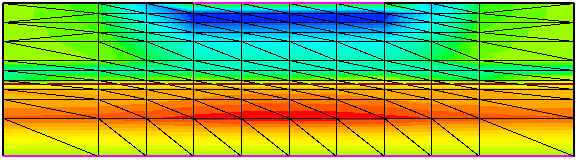 | 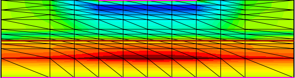 |
| 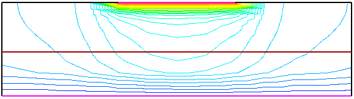 | 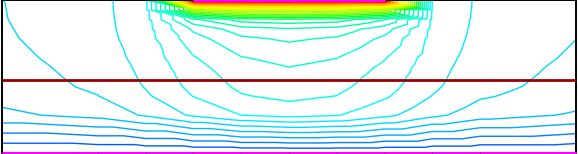 |
| 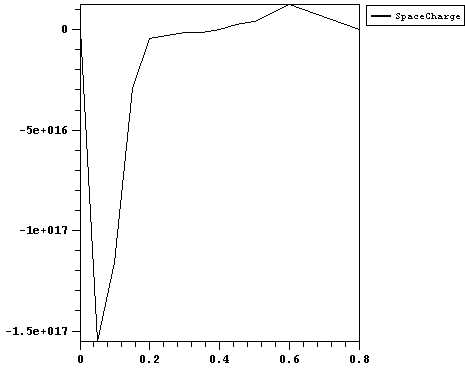 | 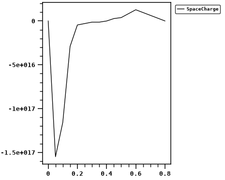 |

Ток при 4 В: **0.00580 А** против эталонных 0.00577 А (+0.5%). Сетка совпадает
с эталонной узел в узел.

**Что пришлось понять по дороге:**

- **`MaxElementSize` — не размер ячейки, а потолок.** Генератор `mesh` делит
  область пополам, пока ячейка не станет меньше потолка. Поэтому `0.2` на окне
  шириной 2 мкм даёт 0.125, а не 0.2. Из-за этого первая сетка была вдвое гуще
  эталонной, и ток расходился с эталоном на 9%.
- **Областей сгущения три, а не две.** Если считать линии сетки на эталонной
  картинке отдельно внутри окна у анода и снаружи, видно, что верхняя половина
  мельче нижней по всей ширине, а у анода ещё мельче. Двумя областями так не
  выйдет: либо верх грубый, либо низ лишний раз поделён. Третья область `Mesh3`
  на верхнюю половину это решает.
- **На краю анода особенность поля.** Минимум заряда сидит ровно в x = −0.5,
  на краю контакта, и не сходится при сгущении сетки (108 узлов дают
  −1.14·10<sup>17</sup>, 349 узлов −2.38·10<sup>17</sup>). Привязывать к нему цветовую шкалу
  нельзя — цвет будет гулять от любой правки сетки.
- **Отрисовка снята с эталона по пикселям**, а не «похоже»
  ([tools/ise_style.py](tools/ise_style.py)): ровно 31 цветовой уровень от (0,42,255)
  до (153,0,0); заряд — в шкале ареасинуса; потенциал — только линии уровня на
  белом; линия p-n перехода (153,0,0) — отдельный рисуемый объект, а не контур
  поля; контакты пурпурным поверх рамки.
- **Главное в шкале — где она применяется.** В picasso команда называется
  `device interpol <набор> linear | log | arsinh`, и ключевое слово тут
  *interpol*: преобразуются значения **в узлах**, интерполяция внутри
  треугольника идёт уже в преобразованных величинах, и только потом результат
  режется на полосы. Если интерполировать по исходным значениям, а логарифм
  применять только к границам полос, картинка выходит заметно краснее: через
  толстую ячейку у катода большое значение протягивается далеко вниз. Расхождение
  с эталоном по площади цветов от этого падает с 22.6% до 12%.

## Лабораторная 2. Тот же диод на сетке вдвое мельче

Повторяем работу 1, уменьшив ячейки вдвое, и сравниваем. Смысл: решение
зависит от сетки. Плюс задание 4 — та же структура без внешнего напряжения.

Мельче становится не всё подряд: задание требует уменьшить ячейки вдоль Oy, и
эталон это подтверждает. По Ox краевые ячейки первой сетки остаются 0.5 мкм.
У второй сетки (окно у анода) шаг по Oy трогать нельзя — иначе у анода
появляются лишние слои, которых в эталоне нет.

| | Mesh1 Max | Mesh1 Min | Mesh2 Max | Mesh2 Min |
|---|---|---|---|---|
| лаба 1 | (0.5 0.2) | (0.1 0.05) | (0.25 0.1) | (0.05 0.025) |
| лаба 2 | (0.5 0.1) | (0.1 0.025) | (0.125 0.1) | (0.025 0.0125) |

**Файлы:**

| | |
|---|---|
| [Lab2_diode_MESH.ipynb](Lab2_diode_2D_mesh/Lab2_diode_MESH.ipynb) | блокнот |
| [ise/sh1.cmd](Lab2_diode_2D_mesh/ise/sh1.cmd) | сетка вдвое мельче |
| [ise/sh1_des.cmd](Lab2_diode_2D_mesh/ise/sh1_des.cmd), [sh1_des0.cmd](Lab2_diode_2D_mesh/ise/sh1_des0.cmd) | решатель: 4 В и 0 В (задание 4) |
| [ise/sh1_msh.grd](Lab2_diode_2D_mesh/ise/sh1_msh.grd), [sh1_des.dat](Lab2_diode_2D_mesh/ise/sh1_des.dat), [sh1_des.plt](Lab2_diode_2D_mesh/ise/sh1_des.plt), [sh1_des_plt.plt](Lab2_diode_2D_mesh/ise/sh1_des_plt.plt) | результаты при 4 В |
| [ise/v0_sh1_msh.grd](Lab2_diode_2D_mesh/ise/v0_sh1_msh.grd), [v0_sh1_des.dat](Lab2_diode_2D_mesh/ise/v0_sh1_des.dat), [v0_sh1_des_plt.plt](Lab2_diode_2D_mesh/ise/v0_sh1_des_plt.plt) | результаты при 0 В |

**Результат:**

| эталон | наш расчёт |
|---|---|
| 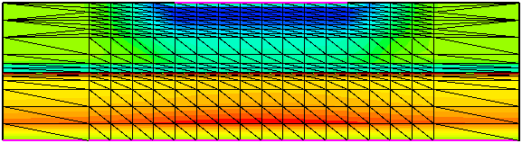 | 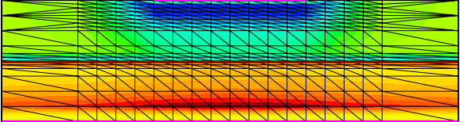 |
| 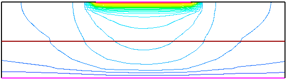 | 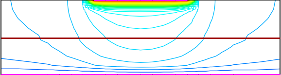 |
| 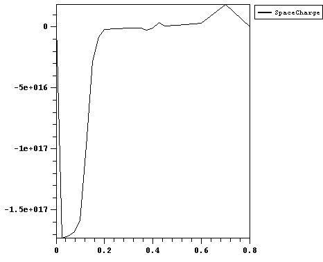 | 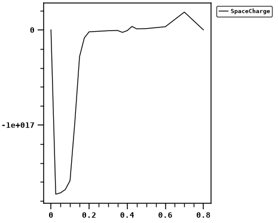 |
| 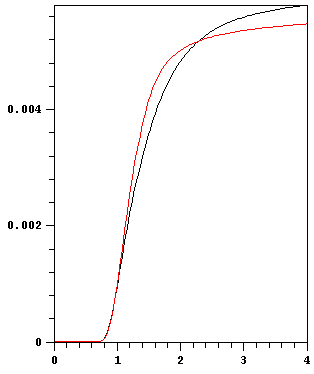 | 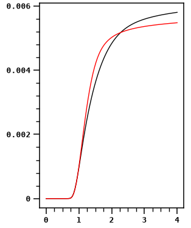 |
| 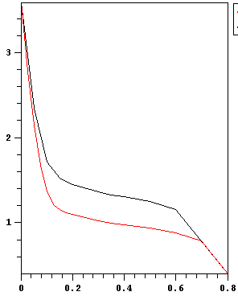 | 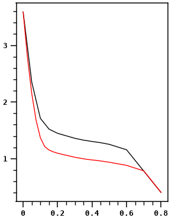 |
| 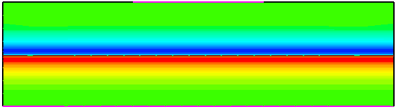 | 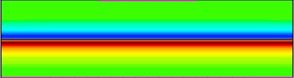 |
| 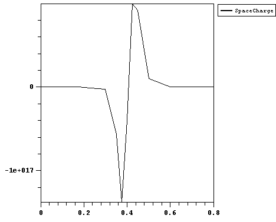 | 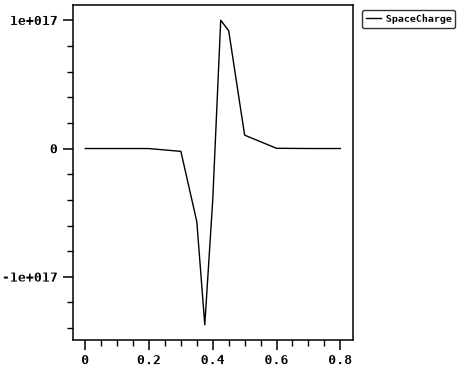 |

Ток при 4 В: **0.00548 А**, совпадает с эталоном. Лабы 1 и 2 сданы.

## Лабораторная 3. 3D диод

Параллелепипед кремния 1 × 3 × 0.8 мкм, переход посередине по высоте, анод
сверху, катод — вся нижняя грань. Два диода отличаются только анодом:

- **диод A** — анод на всю ширину (x от 0 до 1, y от 1 до 2 мкм);
- **диод B** — анод вдвое уже (x от 0.5 до 1), его край приходится на середину
  верхней грани.

Задания: структура обоих диодов, ВАХ, плотность тока вдоль верхней границы
сечения y = 1.5, распределение заряда в трёх сечениях.

### Сводные листы

Все восемь позиций задания рядом с эталоном:

- [results/python/СВОДНЫЙ_ЛИСТ.png](Lab3_diode_3D/results/python/СВОДНЫЙ_ЛИСТ.png) — **итоговый**: свой решатель, все позиции закрыты;
- [results/ise/СВОДНЫЙ_ЛИСТ.png](Lab3_diode_3D/results/ise/СВОДНЫЙ_ЛИСТ.png) — что дал ISE: диод A полностью, диод B только при 0 В;
- [results/вах_питон_против_ISE.png](Lab3_diode_3D/results/вах_питон_против_ISE.png) — проверка своего решателя по диоду A.

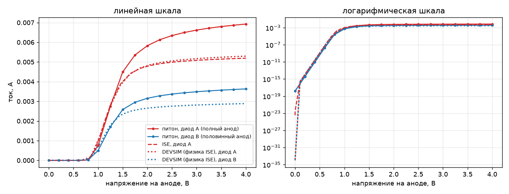

### Что было с ISE

**Первая причина — не тот линейный решатель.** Командный файл собирался по
шаблону от лаб 1–2, а там нет строки `method`. По умолчанию `dessis` берёт
`Blocked`, а мануал прямо пишет, для чего какой:

| решатель | для чего |
|---|---|
| `ParDiSo`, `Super` | один прибор, сетка до 10 000 узлов |
| `Slip` | один прибор, больше 8000 узлов |
| `Blocked` | задачи с несколькими приборами (смешанный режим) |

С `method=slip` (как в файле преподавателя) связанный расчёт пошёл. Без него
решатель печатал заголовок таблицы итераций и умирал, не сделав ни одной.

**Диод A сошёлся полностью:** 26 точек до 4 В, 5.19 мА.
**Диод B — нет.** Перебрано: `slip`, `super`, `pardiso`, `blocked`, пять
схем управления шагом, огрубление сетки у анода, память виртуалки с 1 до 3 ГБ.
На 3 ГБ он перестал падать сразу и доходил до 0.04–0.4 В — каждый раз по-разному,
иногда расходясь в `1.#QNAN`. Отличие B от A только в аноде: край на x = 0.5
приходится на середину грани, там особенность поля. У преподавателя B считался
при толщине 2 мкм, а по варианту 2 толщина 0.8, и ячейки по Oz сжаты в 2.5 раза.

**Грабли по дороге:**

- **Нулевой код возврата ничего не значит.** `dessis` запускает два процесса,
  код возврата принадлежит пусковому, а рабочий может быть мёртв. Батник при этом
  дописывает «ALL DONE». Проверять надо результат — сколько точек в `.plt`, —
  а не код возврата и не лог батника.
- **`at` копит задания.** Старые задания висели в очереди и перезапускали батник
  поверх идущего расчёта, затирая файлы. Перед каждым запуском —
  `at /delete /yes` и проверка `at`.
- **`taskkill` по дочерним процессам не останавливает сам батник** — он доходит
  до конца и создаёт видимость успешного прогона.
- **Память виртуалки** поднимается в `config.plist` UTM только при **закрытом
  приложении UTM**: иначе оно держит конфиг у себя и запускает QEMU со старым
  числом, хотя в файле уже новое. Проверять в госте:
  `systeminfo | findstr "Полный объем"`.

**Файлы ISE:**

| | |
|---|---|
| [ise/sA.bnd](Lab3_diode_3D/ise/sA.bnd), [sB.bnd](Lab3_diode_3D/ise/sB.bnd) | геометрия диодов A и B |
| [ise/sA.cmd](Lab3_diode_3D/ise/sA.cmd), [sB.cmd](Lab3_diode_3D/ise/sB.cmd) | сетка и легирование |
| [ise/sA_des.cmd](Lab3_diode_3D/ise/sA_des.cmd), [sB_des.cmd](Lab3_diode_3D/ise/sB_des.cmd) | решатель, `method=slip` |
| [ise/runAll.bat](Lab3_diode_3D/ise/runAll.bat) | весь прогон: сетки, решения, срезы, линии |
| [ise/cuts.bat](Lab3_diode_3D/ise/cuts.bat) | только срезы, если решения уже есть |
| [ise/cutAy.txt](Lab3_diode_3D/ise/cutAy.txt), [cutBy.txt](Lab3_diode_3D/ise/cutBy.txt), [cutBx75.txt](Lab3_diode_3D/ise/cutBx75.txt), [cutBx25.txt](Lab3_diode_3D/ise/cutBx25.txt) | плоскости сечений для `dfisetools -cut` (точка, затем нормаль) |
| [ise/topline.txt](Lab3_diode_3D/ise/topline.txt) | линия вдоль верхней границы сечения для `dfisetools -plot` |
| [ise/sA_msh.grd](Lab3_diode_3D/ise/sA_msh.grd), [sA_msh.dat](Lab3_diode_3D/ise/sA_msh.dat), [sB_msh.grd](Lab3_diode_3D/ise/sB_msh.grd), [sB_msh.dat](Lab3_diode_3D/ise/sB_msh.dat) | 3D-сетки (тетраэдры) |
| [ise/sA_des.plt](Lab3_diode_3D/ise/sA_des.plt), [sB_des.plt](Lab3_diode_3D/ise/sB_des.plt) | ВАХ |
| [ise/Ay.grd](Lab3_diode_3D/ise/Ay.grd) + `.dat`, [By.grd](Lab3_diode_3D/ise/By.grd) + `.dat`, [Bx75.grd](Lab3_diode_3D/ise/Bx75.grd) + `.dat`, [Bx25.grd](Lab3_diode_3D/ise/Bx25.grd) + `.dat` | срезы |
| [ise/AyTop.plt](Lab3_diode_3D/ise/AyTop.plt), [ByTop.plt](Lab3_diode_3D/ise/ByTop.plt) | поля вдоль верхней границы сечения |

### Свой 3D-решатель

ISE второй диод не берёт, поэтому написан свой трёхмерный дрейф-диффузионный
расчёт — [tools/dd3d.py](tools/dd3d.py). Чем он отличается от ISE и почему это
сработало:

- **сетка тензорная**, а не из тетраэдров: прибор — параллелепипед, генератор
  сетки не нужен, вырожденных элементов не бывает в принципе. Сгущение к
  переходу и к краям анода — геометрической прогрессией по каждой оси;
- **итерация Гуммеля** вместо связанного Ньютона: Пуассон, затем электроны,
  затем дырки, по кругу, с демпфированием. Медленнее, но берёт то, на чём ISE
  разваливается;
- **потоки по Шарфеттеру — Гуммелю** — без них экспоненциальные профили
  концентраций не считаются;
- **подвижность**: зависимость от легирования (Коги — Томас) и **насыщение
  скорости** (v<sub>sat</sub> = 1.07·10<sup>7</sup> см/с). Без насыщения ток не выходит на полку и
  завышен вдвое — проверено;
- переменные — потенциал и **квазиуровни Ферми**: Пуассон решается Ньютоном с
  пересчётом концентраций на каждой итерации, иначе сходимость линейная.

**Проверка на диоде A, который ISE посчитал:**

| ток, А | 1 В | 4 В (полка) |
|---|---|---|
| ISE | 9.8·10<sup>−4</sup> | 5.2·10<sup>−3</sup> |
| свой | 7.6·10<sup>−4</sup> | 6.9·10<sup>−3</sup> |

Систематика: −23% на малом токе и +33% на полке. Обе объяснимы: у ISE включены
`BandGapNarrowing` (сужение запрещённой зоны поднимает ток при малом смещении)
и `Enormal` (падение подвижности у поверхности снижает полку), а в своём
решателе ни того, ни другого нет.

**Главное — контраст между диодами**, ради которого лаба и делается:

| | свой расчёт | эталон |
|---|---|---|
| 2 В | B ниже A на 46% | 34% |
| 3 В | B ниже A на **47%** | **45%** |

Систематический сдвиг у обоих диодов одинаков и при сравнении сокращается.

Независимая проверка плотности тока: 6.4·10<sup>5</sup> А/см² из потоков по рёбрам
против 6.9·10<sup>5</sup> из «полный ток делить на площадь анода».

Диод B считается так же устойчиво, как A: 4–6 итераций Гуммеля на точку.
Сетки 14 421 узел (A) и 17 457 узлов (B), развёртка до 4 В — 50 и 75 минут
на M1.

**Файлы:**

| | |
|---|---|
| [tools/dd3d.py](tools/dd3d.py) | решатель: сетка, Пуассон, непрерывность, Гуммель, ток контакта |
| [tools/py3d_plots.py](tools/py3d_plots.py) | срезы и плотность тока на верхней грани в стиле ISE |
| [python/sweep.py](Lab3_diode_3D/python/sweep.py) | развёртка по напряжению, запуск из терминала |
| [python/compare.py](Lab3_diode_3D/python/compare.py) | ВАХ своего решателя против ISE |
| [python/iv_A.npz](Lab3_diode_3D/python/iv_A.npz), [iv_B.npz](Lab3_diode_3D/python/iv_B.npz) | ВАХ |
| [python/field_A.npz](Lab3_diode_3D/python/field_A.npz), [field_B.npz](Lab3_diode_3D/python/field_B.npz) | поля при 4 В: потенциал, n, p, легирование |
| [python/sweepA.log](Lab3_diode_3D/python/sweepA.log), [sweepB.log](Lab3_diode_3D/python/sweepB.log) | логи развёрток |
| [make_figures.py](Lab3_diode_3D/make_figures.py) | все картинки и оба сводных листа |

Повторить расчёт (около часа на диод):

```bash
cd Lab3_diode_3D/python
python sweep.py "[0,1,1,2]"   A 10 14 9 4
python sweep.py "[0.5,1,1,2]" B 10 14 9 4
```

### DEVSIM: заготовка под мелкую сетку

Следующий шаг — тот же диод на неструктурированной сетке с настоящим
сгущением к переходу и кромкам анода. Для этого взяты открытые пакеты
[DEVSIM](https://devsim.org) (решатель методом конечных объёмов, Python) и
[Gmsh](https://gmsh.info) (сетка). Переход и анод встроены в геометрию как
поверхности, поэтому ступенька легирования и край контакта ложатся точно на
узлы ([tools/mesh3d.py](tools/mesh3d.py), [tools/dev3d.py](tools/dev3d.py)).

Запуск одной командой — [devsim/run.py](Lab3_diode_3D/devsim/run.py):

```bash
cd Lab3_diode_3D/devsim
python run.py A                # мелкая сетка, около 104 тыс. узлов
python run.py B
python run.py A --scale 2.5 --relerr 1e-5   # грубая, около 8 тыс. узлов — проверка, что всё работает
```

**Упор в память.** Нужен прямой решатель: итерационный GMRES под смещением
сообщает о сходимости на неправильном решении. Прямой (UMFPACK) на 34 тыс. узлов
занимает около 2.6 ГБ, на 104 тыс. — по оценке около 10 ГБ. На маке с 8 ГБ
мелкая сетка не помещается, её надо считать на машине с 16–32 ГБ ОЗУ.

### DEVSIM с физикой ISE: оба диода, совпадение с эталоном

Посчитано на ПК (FX-8320, 32 ГБ, TITAN X). Итог — справа: на сетке
преподавателя оба диода ложатся на эталон в пределах 1–3 % от 2 до 4 В.

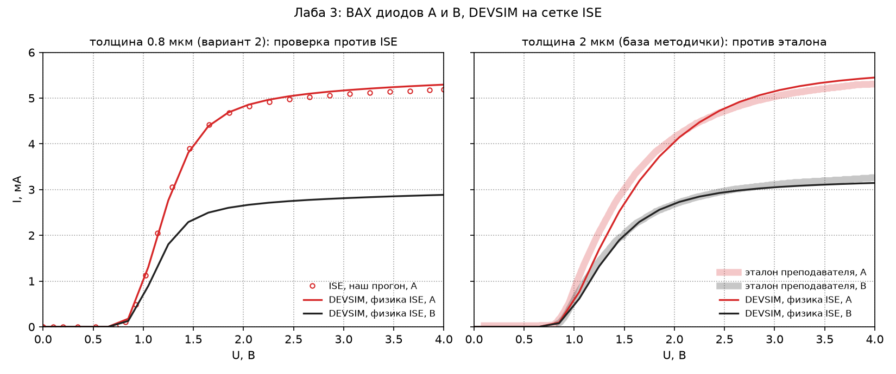

**Что пришлось понять по дороге:**

- **Физика — из командного файла ISE, а не из `dd3d`.** `sA_des.cmd` включает
  `Mobility(DopingDep HighFieldsat Enormal)` и `BandGapNarrowing(OldSlotboom)`,
  рекомбинации нет. Это модель Масетти по легированию, насыщение Канали
  (v<sub>sat</sub> = 1.07·10<sup>7</sup> / 8.37·10<sup>6</sup> см/с, β = 1.109 / 1.213 для
  электронов / дырок), сужение зоны по Слотбуму — [tools/dev_ise.py](tools/dev_ise.py).
  Коги — Томас с SRH давали 9.8–21 мА вместо 5.2.
- **Насыщение у ISE 7 — по полю, а не по градиенту квазиуровня Ферми**, как в
  новых Sentaurus. С квазиуровнем излом ВАХ вдвое выше ISE (2.58 против 1.34 мА
  при 1.05 В), а наклон при малых токах n = 1.03 вместо 1.00. С полем — оба совпадают.
- **DEVSIM 2.11 в 3D завышает ячейки контрольных объёмов.** Площади граней ячеек
  Вороного он складывает по модулю, и на тетраэдрах с центром сферы снаружи
  получается лишнее: объём прибора на сетке ISE 3.06 мкм³ вместо 2.4, на сетке Gmsh
  — 4.54. Проводимость рёбер завышена так же, ток — на 10 % (сетка ISE) и вдвое
  (Gmsh, отсюда прежние 10–12 мА). Площади пересчитаны со знаком
  ([tools/voronoi3d.py](tools/voronoi3d.py)) и подставлены поправкой к потокам и
  зарядам — объём ровно 2.4.
- **Сетка — та же, что у ISE.** Тетраэдры, контакты и легирование в узлах читаются
  прямо из `sA_msh.grd` / `sA_msh.dat` ([tools/ise_grid.py](tools/ise_grid.py)).
  Анод B — правая половина анода A на той же сетке: линия x = 0.5 у неё — линия
  узлов. Проверка сходимости — тензорные сетки на осях ISE
  ([tools/tensor_mesh.py](tools/tensor_mesh.py)): 20 тыс. узлов отличаются от
  сетки ISE меньше чем на 0.5 %.
- **n<sub>i</sub> = 1.4385·10<sup>10</sup> см<sup>−3</sup>** — откалибровано по ВАХ ISE при
  0.1–0.5 В (там ток ∝ n<sub>i</sub>², отношение к ISE постоянно).
- **Эталон посчитан при толщине 2 мкм**, базовой структуре методички, а не при
  0.8 по варианту. При 0.8 мкм наш DEVSIM совпадает с нашим ISE (слева, 1–2 % на
  1.5–4 В), но излом у эталона мягче, а B выше на 11 %. Сетка ISE, растянутая по z
  обратно в 2.5 раза (то есть сетка методички), даёт эталон:

| U, В | A, мА | эталон A | B, мА | эталон B | B ниже A | эталон: B ниже A |
|---|---|---|---|---|---|---|
| 1.5 | 2.69 | 3.01 | 2.00 | 2.03 | 26 % | 33 % |
| 2.0 | 4.04 | 4.14 | 2.69 | 2.68 | 33 % | 35 % |
| 2.5 | 4.77 | 4.71 | 2.94 | 2.96 | 38 % | 37 % |
| 3.0 | 5.15 | 5.03 | 3.05 | 3.11 | 41 % | 38 % |
| 3.95 | 5.44 | 5.30 | 3.14 | 3.25 | 42 % | 39 % |

  Эталон снят с `reference/z2_вах.png` по пикселям
  ([devsim/reference_iv.py](Lab3_diode_3D/devsim/reference_iv.py)); ниже 1.5 В,
  где кривая круче всего, точность чтения хуже.

**Численные грабли на этой машине:**

- **Прямой решатель.** MKL 2025.0 Pardiso на FX-8320 отдаёт нулевую поправку
  после первой итерации — «сходимость» на мусоре. MKL 2023.1 работает (он и стоит
  в окружении), UMFPACK — тоже. Видеокарта подключается к DEVSIM как внешний
  решатель cuDSS ([tools/cudss_shim.py](tools/cudss_shim.py)): без уравновешивания
  строк и столбцов матрицы (строки Пуассона ~10<sup>−16</sup> против единиц у контактов)
  он врёт; с ним токи совпадают с UMFPACK до шестого знака. Потолок TITAN X —
  около 200 тыс. неизвестных.
- **Расширенная точность.** Ток Шарфеттера — Гуммеля — разность больших потоков,
  концентрации гуляют от 10<sup>3</sup> до 10<sup>17</sup> см<sup>−3</sup>; в double Ньютон
  застревает на 10<sup>−5</sup>, ток при 0.1 В выходит миллиамперами. С
  `extended_model` + `extended_equation` (float128) сходимость квадратичная до
  10<sup>−11</sup>. Нужно только при малых токах — выше 0.7 В хватает double.
- **Эмуляция FP64 парами float32 на GPU не окупается**: итерационный решатель
  упирается в память, а не в арифметику (замеры — `experiments/gpu_precision/`).

Повторить (около 40 минут на диод, из них 10 — float128 при малых смещениях):

```bash
cd Lab3_diode_3D/devsim
python run_ise.py A                 # 0.8 мкм, сетка ISE, сравнение с ise/sA_des.plt
python run_ise.py B                 # B на сетке A
python run_ise.py A --lz 2          # 2 мкм — сетка методички, сравнение с эталоном
python run_ise.py B --lz 2
python run_ise.py A --tensor 1 --fast   # проверка сходимости по сетке
python plot_ise.py                  # картинка и таблицы
```

## Лабораторные 4 и 5

Не сделаны. Лаба 4 — полевой транзистор на гетероструктуре GaAs/AlGaAs с
затвором Шоттки, лаба 5 — смешанный режим (прибор в схеме, транзиент).
Обе инфраструктурно проверены на пробных запусках (см. таблицу скорости в
[разделе про ISE](#сколько-это-считается)), сами работы — впереди.

---

## Обвязка: что лежит в `tools/`

| файл | что делает |
|---|---|
| [xp.py](tools/xp.py) | свой telnet-клиент к Windows XP: согласование опций, ожидание приглашения `>`, перекодировка cp866, чистка ANSI. `xp.run([...])` — выполнить команды, `xp.fetch(путь, куда)` — забрать файл (с проверкой на мусор и повтором) |
| [put.py](tools/put.py) | залить текстовый файл внутрь XP построчно через `echo`, без общих папок |
| [dfise.py](tools/dfise.py) | чтение формата DF-ISE: сетка 2D и 3D, элементы через рёбра, поля по регионам |
| [viz.py](tools/viz.py) | чтение `.plt` (ВАХ, распределения) и отрисовка на Plotly |
| [ise_style.py](tools/ise_style.py) | отрисовка в стиле picasso/inspect, снятом с эталона по пикселям |
| [ise3d.py](tools/ise3d.py) | 3D: структура прибора и срезы внутри каркаса |
| [compare.py](tools/compare.py) | эталон, наша картинка и вывод picasso друг под другом |
| [sheet.py](tools/sheet.py) | сводный лист «эталон — наш расчёт» по всем позициям лабы |
| [gen_variants.py](tools/gen_variants.py) | проекты ISE для всех 25 вариантов лаб 1–2 |
| [dd3d.py](tools/dd3d.py) | свой 3D дрейф-диффузионный решатель |
| [py3d_plots.py](tools/py3d_plots.py) | картинки по результатам `dd3d` |
| [mesh3d.py](tools/mesh3d.py) | сетка 3D-диода в Gmsh для DEVSIM |
| [dev3d.py](tools/dev3d.py) | диод в DEVSIM: загрузка сетки, легирование, равновесие, развёртка |
| [guest/startx.bat](tools/guest/startx.bat) | запуск X-сервера внутри XP из его собственной папки |
| [guest/XWINPRO.ini](tools/guest/XWINPRO.ini) | конфиг X-сервера: пути к шрифтам без пробелов |
| [guest/init.pic](tools/guest/init.pic) | скрипт picasso: заряд с сеткой, контактами и переходом, как в эталоне |

---

## ISE TCAD 7.0 на Apple Silicon: как это запустить

*Перевод и дополнение заметки
[ISE TCAD 7.0 on Apple Silicon: Running a 2001 semiconductor package on a MacBook Air M1](https://libretimes.io/works/01a063b5-d966-7030-966d-42660150d2cb).*

Задача звучала просто: сделать лабораторные по моделированию полупроводниковых
приборов. Подвох в том, что они идут на TCAD-пакете старше большинства
студентов курса, собранном под Windows NT и Intel, — а под рукой ARM-макбук.
Ниже — как это прошло и все грабли по дороге. Всё проверено запуском, а не
догадками.

### Что это за пакет

ISE TCAD 7.0 выпускала Integrated Systems Engineering AG из Цюриха. В 2004 году
компанию купил Synopsys, и продукт стал Sentaurus TCAD — тем самым, что стоит
в половине микроэлектронных лабораторий мира.

Родство видно невооружённым глазом: решатель до сих пор называется DESSIS,
формат данных — DF-ISE, а в современных мануалах Sentaurus иногда проскакивают
старые имена программ. Пакет 2001 года — прямой предок нынешнего.

Что нужно для работы:

| программа | назначение | интерфейс |
|---|---|---|
| `mesh` | сетка по описанию геометрии | консоль |
| `dessis` | решает уравнения Пуассона и непрерывности | консоль |
| `dfisetools` | разрезы, распределения вдоль линии | консоль |
| `mdraw` | графический редактор структуры | X11 |
| `inspect` | графики: ВАХ, разрезы, осциллограммы | X11 |
| `picasso`, `tecplot_ise` | 2D- и 3D-карты полей | X11 |

Одна деталь важнее всех остальных: **ISE 7.0 под Windows — это юниксовый
пакет, портированный через Cygwin.** Отсюда и X-сервер в комплекте, и
большая часть странностей ниже.

### Стенд

```
MacBook Air M1 (ARM64)
  └─ UTM 4.7.5, полная эмуляция x86
       └─ QEMU, цель i386
            └─ Windows XP SP3
                 ├─ ISE TCAD 7.0 (порт через Cygwin)
                 ├─ X-сервер Labtam X-WinPro
                 └─ встроенный Telnet-сервер
```

Самописный telnet-клиент на Python ([tools/xp.py](tools/xp.py)) заходит с мака
в гостевую систему; через него запускаются расчёты и забираются результаты.
Всем управляет Jupyter.

Виртуальный диск — около шести гигабайт, гостю хватает одного гигабайта ОЗУ
(для 3D-задач больше — см. лабу 3).

### Грабля первая: XP не ставится

Установка Windows намертво висела на первом же экране — *«Setup is inspecting
your computer's hardware configuration»*.

Смотрим, как UTM запускает QEMU:

```
-machine pc,vmport=off,i8042=off,hpet=off
```

`i8042=off` отключает контроллер клавиатуры PS/2. Современным системам он не
нужен — хватает USB HID, — поэтому UTM выключает его по умолчанию. Но
NTDETECT в Windows XP при старте ищет именно контроллер 8042 и без него
зависает навсегда.

Это известная проблема UTM, [#3723](https://github.com/utmapp/UTM/issues/3723).
Лечится включением PS/2 в настройках виртуалки; в конфиге это ключ
`PS2Controller`. После этого флаг пропадает из командной строки, и установка
идёт нормально.

Полезный побочный эффект: без контроллера PS/2 не работала бы и клавиатура
в текстовом режиме установки, а там нужны Enter и F8.

### Управление из терминала

Кликать по эмулированному рабочему столу быстро надоедает; цель была
запускать расчёты скриптами. В XP Professional для этого есть встроенный
Telnet Server — ставить ничего не надо:

```
sc config tlntsvr start= auto
net start tlntsvr
tlntadmn config sec=-NTLM +passwd
```

Третья строка обязательна. По умолчанию сервер требует NTLM-аутентификацию,
которую юниксовые клиенты не умеют, и вход молча не проходит.

В брандмауэре XP нужно открыть порт:

```
netsh firewall set portopening TCP 23 Telnet ENABLE
```

**Системный telnet с мака не работает.** Он подключается и молчит. Дамп
трафика показал, что сервер честно шлёт согласование опций и ждёт ответа:

```
FF FB 01   IAC WILL ECHO
FF FB 03   IAC WILL SUPPRESS-GO-AHEAD
FF FD 27   IAC DO NEW-ENVIRON
FF FD 1F   IAC DO NAWS
FF FD 00   IAC DO BINARY
```

Клиент и сервер так и не договариваются. Решение — свой маленький клиент:
принимать только ECHO и SGA, представляться терминалом VT100, остальное
вежливо отклонять.

Вторая важная деталь: **следующая команда отправляется только после
появления приглашения `>`**, а не по таймеру. Иначе команда попадает в
середину идущего расчёта. `dessis` считает минутами, и без синхронизации по
приглашению всё разваливается.

Третья: вывод приходит в cp866 с ANSI-последовательностями позиционирования
курсора, их надо вычищать. Помогает перевод сервера в потоковый режим:

```
tlntadmn config mode=stream
```

**Долгие расчёты — через планировщик.** Windows убивает всё дерево процессов
вместе с telnet-сессией; ни `start /b`, ни `start` с отдельной консолью не
спасают. Работает планировщик заданий:

```
at HH:MM C:\tcad\LAB3\runAll.bat
```

Задачу запускает служба `Schedule`, от telnet-сессии она не зависит. Три
ранних «падения» сложных задач (трек иона на 0.94 нс, транзиент на 5-м шаге,
развёртка на 85 пс) оказались одним и тем же: расчёт просто не доживал до
конца вместе с сессией.

### Грабля вторая: пробел в пути убивает программу

Счётная часть заработала сразу. А графические программы вели себя странно:
окно вспыхивало на секунду и пропадало. Ни ошибки, ни лога.

Перехват вывода всё объяснил:

```
ls: C:\Documents: No such file or directory
ls: and: No such file or directory
ls: Settings\User\Desktop: No such file or directory
```

Вот оно. `picasso` — юниксовая программа, и внутри она вызывает `ls` на
текущую папку **без кавычек вокруг пути**. Путь вида
`C:\Documents and Settings\...\Desktop\` разваливается по пробелам, программа
не может прочитать рабочую папку и молча выходит.

**Держите проекты в пути без пробелов и без кириллицы** — `C:\tcad\`
работает. Консольным `mesh`, `dessis` и `dfisetools` это не страшно: они
получают имена файлов аргументами.

### Грабля третья: окна, запущенные по telnet, не появляются

Следующая странность: программа работает, видна в списке процессов, честно
жжёт процессор — а окна нигде нет.

Причина в устройстве Windows: процесс, запущенный из telnet-сессии, попадает в
отдельную оконную станцию, и его окна на интерактивном рабочем столе не
рисуются.

Была разумная надежда, что X11 это обойдёт — клиент говорит с X-сервером по
TCP, окно создаёт сервер, а он живёт в консольной сессии. **Гипотеза проверена
и не подтвердилась**: окно всё равно не появляется.

Рабочее разделение в итоге такое:

- **по telnet** — всё счётное, оно и так консольное;
- **из консоли самой Windows** — графические программы, через меню «Пуск».

X-сервер должен быть запущен первым, иначе клиентам не к чему подключаться.

### picasso и X-сервер: что удалось и что нет

Хотелось получать картинки родной программой, а не подражанием. Вот что вышло.

**X-сервер (Labtam X-WinPro) поднимается, picasso на нём рисует.** Две грабли:

- запускать `xserver.exe` **из его собственной папки**
  ([tools/guest/startx.bat](tools/guest/startx.bat)), иначе он ищет конфиг в
  `system32`, не находит и виснет на модальном окне «FontPath is completely
  invalid» — порт 6000 при этом не слушается;
- пути к шрифтам в `XWINPRO.ini` не должны содержать пробелов: короткие имена
  `PROGRA~1` не работают, генерация имён 8.3 на томе отключена. Поэтому шрифты
  скопированы в `C:\xfonts`, конфиг смотрит туда
  ([tools/guest/XWINPRO.ini](tools/guest/XWINPRO.ini)).

**Чего не вышло:** сохранить картинку из picasso скриптом. `picasso -batch`
работает — TCL 8.2 исполняется, прибор грузится, команды проходят, — но запись
PostScript роняет программу. `page save`, `window save`, `page dump`
отчитываются успехом и не пишут файл. Поэтому третья панель в блокнотах
(«вывод самого picasso») ручная. Как получить её руками:

1. Поднять X-сервер (см. выше).
2. Запустить picasso из консоли XP:

   ```
   set DISPLAY=127.0.0.1:0
   cd /d C:\tcad\LAB1
   C:\ISE\bin\picasso sh1_msh.grd sh1_des.dat
   ```

3. В панели Model выбрать набор `SpaceCharge`, включить `rainbow`, в Draw style
   оставить `face`, `edge`, `contact`, `junction`. Шкалу —
   Device → interpol → arsinh.
4. Снять окно и положить PNG в папку `picasso/` в корне репозитория с именем как у
   эталона (`z1_заряд.png` и т. п.) — блокнот подхватит её третьей панелью.

Те же команды в виде TCL — [tools/guest/init.pic](tools/guest/init.pic):
picasso сам подхватывает `init.pic` из текущей папки.

Из мануала picasso при этом подтвердилось многое из того, что было снято с
эталона по пикселям: линия перехода, контакты и сетка — отдельные рисуемые
объекты (`model sjunction 2.0 brown`, `model scontact 2.0 magenta`,
`model sedge 1.0 black`), а цветовой диапазон задаётся `model range` — ниже
минимума всё синее, выше максимума всё красное.

### Чтение результатов: формат DF-ISE

ISE пишет результаты в собственном текстовом формате. Раз это текст, разумно
разбирать его на Python и рисовать на маке современными средствами
([tools/dfise.py](tools/dfise.py)). У формата две неочевидные особенности.

**Элементы заданы рёбрами, а не вершинами.** Ожидаешь, что треугольник — это
три вершины. На деле это три ребра, а рёбра ссылаются на вершины:

```
Vertices (1957) { 0 0   0 0.2625   0.625 0.2625  ... }
Edges (3994)    { 0 1   1 2   2 3   3 0  ... }
Elements (2071) { 3 0 1 2 3    1 3 0    3 4 5 6 -2  ... }
```

Первое число элемента — его тип: 0 точка, 1 отрезок, 2 треугольник,
3 четырёхугольник, 5 тетраэдр (в 3D он задан уже гранями). Остальное — индексы
рёбер, и **отрицательный индекс значит, что ребро пройдено в обратную
сторону**. Чтобы получить кольцо вершин, рёбра надо обойти и сшить. В 3D
поверхность прибора берётся из блока `Locations`: метки `i`/`e` отмечают
внутренние и внешние грани.

**Поля могут храниться кусками.** У простого прибора поле — один массив на всю
сетку. У структуры из нескольких регионов — по блоку на регион:

```
Dataset ("ElectrostaticPotential") {
  validity = [ "S10" ]
  Values (428) { ... }
}
```

В транзисторе из четырнадцати регионов каждое поле разбито на одиннадцать
таких блоков, их надо сшивать: значения внутри блока идут по возрастанию
глобальных номеров вершин этого региона.

**Контакты тоже лежат в сетке** — обычными регионами из отрезков с материалом
`Contact`. Геометрию контактов надёжнее брать оттуда, а не из `.bnd`: при
смене варианта иначе всё разъедется.

### Отрисовка

Родной визуализатор рисует поля дискретными цветовыми полосами от синего
через зелёный к красному, с тонким чёрным контуром прибора. Одна условность
непривычна: **ось Y направлена вниз** — сечения приборов рисуют так, чтобы
верхний электрод был сверху.

Повторить это в Plotly ([tools/viz.py](tools/viz.py)) или matplotlib
([tools/ise_style.py](tools/ise_style.py)) несложно. Тонкость в том, что сетка
неструктурированная: поле сначала нужно интерполировать на регулярную сетку и
обрезать по исходной триангуляции — иначе заливка вылезет за границу прибора.

Не задавайте осям одинаковый масштаб: для транзистора длиной пятнадцать
микрон и глубиной два это растянет картинку в море пустоты. Лучше вычислять
высоту рисунка из пропорций прибора.

### Сколько это считается

Замеры на одном эмулированном ядре M1:

| задача | узлов | время |
|---|---|---|
| 2D диод, сетка | 162 | 0.5 с |
| 2D диод, развёртка до 4 В | 162 | 33 с |
| 2D транзистор, две развёртки | 1994 | 16 мин |
| 3D диод, развёртка до 4 В | 4711 | 24 мин |
| транзистор в схеме, транзиент 4 мс | 802 | ~35 мин |

Вывод неожиданный: **опасения, что эмуляция будет слишком медленной, не
подтвердились.** Двумерные задачи считаются за секунды. Узкие места — 3D и
транзиенты, но и они укладываются в полчаса: медленно, чтобы раздражать,
но достаточно быстро, чтобы работать.

### Что в итоге

Полностью рабочая цепочка: расчёт запускается из Jupyter одним вызовом,
результаты сами забираются на мак, графики строятся современными средствами.
Сам пакет 2001 года оставлен в точности как был — внутри ничего не
патчилось и не менялось.

Обобщения, которые полезны и за пределами этого пакета:

1. **Старым системам нужны старые контроллеры.** Отключение PS/2 ради
   современности ломает всё, что старше Windows Vista.
2. **Юниксовые программы под Windows ненавидят пробелы в путях** — особенно
   когда внутри вызывают консольные утилиты.
3. **GUI нельзя запустить по telnet.** Разделяйте счётную и графическую части
   работы.
4. **Синхронизируйтесь по приглашению, а не по таймеру.** Это единственный
   надёжный способ управлять долгими задачами через сетевой шелл.
5. **Текстовые форматы — подарок.** Пока данные текстовые, их всегда можно
   прочитать своими средствами, даже когда родной визуализатор отказывается
   запускаться.

Последний пункт оказался самым ценным: свой парсер снял всякую зависимость от
того, работает ли графика внутри виртуалки вообще.

---

## Эксперимент: сбор заряда после удара тяжёлого иона

*Перевод заметки
[Charge Collection After Heavy-Ion Strikes: A material parameter sweep in a 2001 TCAD solver](https://libretimes.io/works/01a066e7-2b5f-7a90-920a-37bd689a22f1).
К программе курса не относится — это проба того, на что способен стенд.*

Это продолжение заметки выше: там была инфраструктура, здесь — что вышло из
реального использования. Коротко: физические результаты скромные, а самым
полезным оказался урок о том, как легко обмануть себя настройками
интегрирования по времени.

### Постановка

Двумерный кремниевый диод с резким p-n переходом. Сетка намеренно маленькая —
**162 вершины, 282 треугольника**, — чтобы один прогон стоил минуты, а не часы.

```
прибор      3.0 × 1.0 мкм
анод        1.0 мкм шириной, верхняя грань (частичный контакт)
катод       вся нижняя грань
переход     посередине по глубине
смещение    −2 В, обратное
```

Анод закрывает только треть верхней грани. Это окажется важным.

Удар иона задаётся встроенным источником тяжёлых ионов
([validation/see_des.cmd](experiments/heavy_ion/validation/see_des.cmd)):

```
HeavyIon (
    Direction = (0,1)
    Location  = (0.0,-0.5)
    Time      = 100e-12
    Length    = 1e-4        ! см, то есть 1 мкм
    Wt_hi     = 0.05e-4     ! см, то есть радиус трека 0.05 мкм
    LET_f     = 0.2         ! пКл/мкм
    Gaussian
    PicoCoulomb
)
```

Две ловушки с единицами, каждая стоила по неудачному прогону: `Length` и
`Wt_hi` задаются **в сантиметрах**, не в микронах, а `LET_f` по умолчанию
в парах на см³, если не добавить ключевое слово `PicoCoulomb`. Ошибись в любой —
и модель молча почти ничего не генерирует. Ни предупреждения, ни ошибки —
просто плоская кривая тока.

### Проверка 1: работает ли источник иона

Базовый прогон на обычном кремнии. Трек оставляет 0.2 пКл/мкм на пути в 1 мкм,
то есть **0.2 пКл всего**.

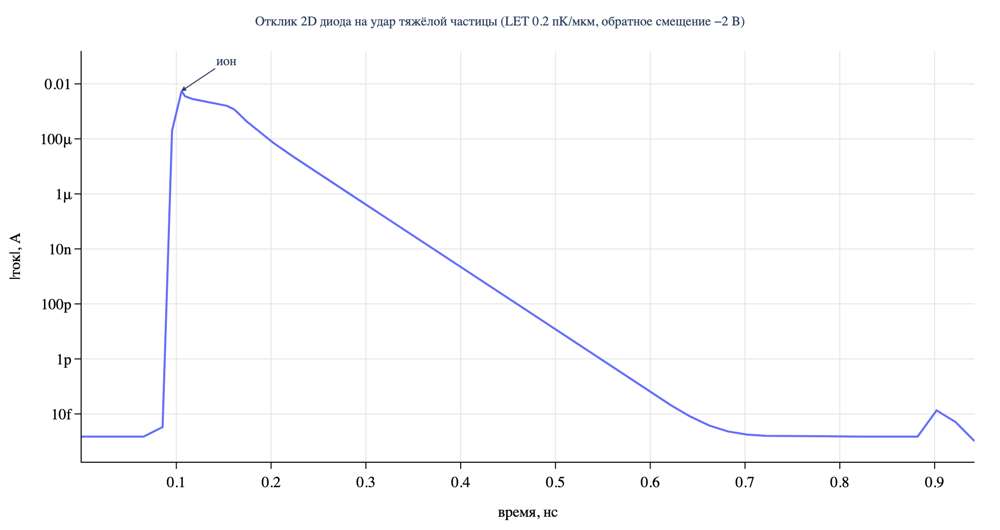

| величина | значение |
|---|---|
| ток утечки до удара | 1.5·10<sup>−15</sup> А |
| пик тока | −5.41 мА при t = 0.1055 нс |
| возврат к утечке | к ≈ 0.6 нс |
| **собранный заряд** | **0.176 пКл** |
| **эффективность сбора** | **88%** |

Ток прыгает на двенадцать порядков и спадает за пару сотен пикосекунд.
88% выделенного заряда доходит до анода, остальное рекомбинирует. И форма, и
величина такие, как и следует ожидать, — ради этого базовый прогон и делается.

Файлы: [see_des.cmd](experiments/heavy_ion/validation/see_des.cmd),
[see_des.plt](experiments/heavy_ion/validation/see_des.plt) (ток),
[ion_see_des.plt](experiments/heavy_ion/validation/ion_see_des.plt).

### Проверка 2: можно ли выдумывать материалы

Решатель грузит параметры материалов из текстовой библиотеки, и расчёт может
переопределить любой из них маленьким файлом
([bandgap/egA.par](experiments/heavy_ion/bandgap/egA.par)):

```
Material = "Silicon" {
    Bandgap {
        Eg0 = 1.40000   # [eV]
        ...
    }
}
```

Заменяются только перечисленные блоки, всё остальное берётся из библиотеки.
Поэтому гипотетические материалы делаются легко: берёшь кремний, меняешь нужные
числа, остальное не трогаешь.

Чтобы проверить, что это действительно меняет физику — и меняет на правильную
величину, — тот же диод посчитан дважды, отличие только в ширине запрещённой
зоны.

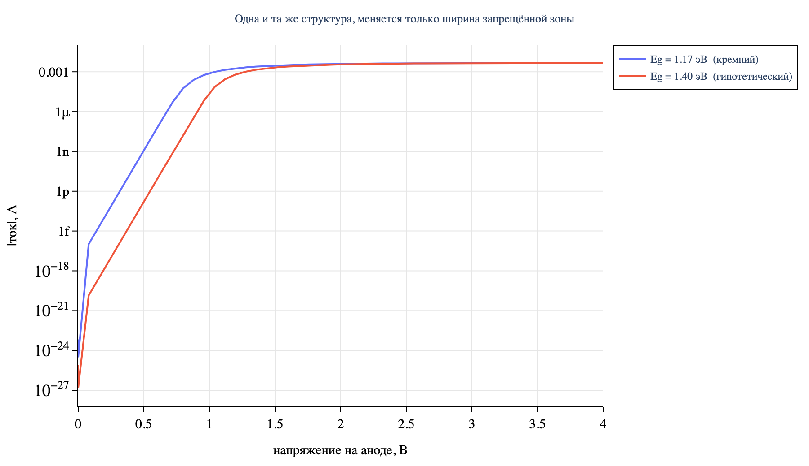

| смещение | I при E<sub>g</sub> = 1.17 эВ | I при E<sub>g</sub> = 1.40 эВ | отношение |
|---|---|---|---|
| 0.5 В | 3.39·10<sup>−9</sup> А | 4.66·10<sup>−13</sup> А | **7260** |
| 1.0 В | 7.85·10<sup>−4</sup> | 3.96·10<sup>−5</sup> | 19.8 |
| 1.5 В | 2.93·10<sup>−3</sup> | 2.10·10<sup>−3</sup> | 1.39 |
| 4.0 В | 4.70·10<sup>−3</sup> | 4.67·10<sup>−3</sup> | 1.01 |

При малом смещении ток пропорционален n<sub>i</sub>², то есть exp(−E<sub>g</sub>/kT). Для
ΔE<sub>g</sub> = 0.2304 эВ при 300 К это даёт отношение

exp(0.2304 / 0.02585) = 7420

против измеренных **7260** — совпадение в пределах 2%. При большом смещении
кривые сходятся: там ток ограничен последовательным сопротивлением, которому
до ширины зоны дела нет.

Значит, механизм подмены работает, и работает количественно.

Файлы: [desA.cmd](experiments/heavy_ion/bandgap/desA.cmd), [desB.cmd](experiments/heavy_ion/bandgap/desB.cmd),
[egA.par](experiments/heavy_ion/bandgap/egA.par), [egB.par](experiments/heavy_ion/bandgap/egB.par),
[pA.plt](experiments/heavy_ion/bandgap/pA.plt), [pB.plt](experiments/heavy_ion/bandgap/pB.plt).

### Физика, которую нельзя забыть

Источник тяжёлых ионов задаёт выделенный **заряд** на микрон, а не выделенную
**энергию**. Если менять ширину зоны при фиксированном `LET_f`, неявно
утверждается, что широкозонный материал рождает столько же электрон-дырочных
пар на единицу пути, сколько узкозонный. Это не так.

Энергия на одну пару подчиняется правилу Кляйна:

E<sub>pair</sub> ≈ 2.8·E<sub>g</sub> + 0.6  [эВ]

поэтому при фиксированной выделенной энергии число пар падает как
1/(2.8·E<sub>g</sub> + 0.6). На взятом диапазоне это в **2.67 раза** меньше носителей при
E<sub>g</sub> = 3.3 эВ, чем в кремнии. Во всех прогонах ниже `LET_f` пересчитан
соответственно.

Пропустите это — и широкозонные материалы будут выглядеть незаслуженно хорошо.

### Развёртка

Девять точек: ширина запрещённой зоны × подвижность электронов, всё остальное
фиксировано — геометрия, сетка, смещение, место удара, выделенная энергия.

```
Eg  ∈ {1.1, 2.2, 3.3}  эВ
µn  ∈ {200, 900, 3000} см²/(В·с)
µp  = µn / 3
```

Точка считается около шести минут, вся развёртка — меньше часа без присмотра.

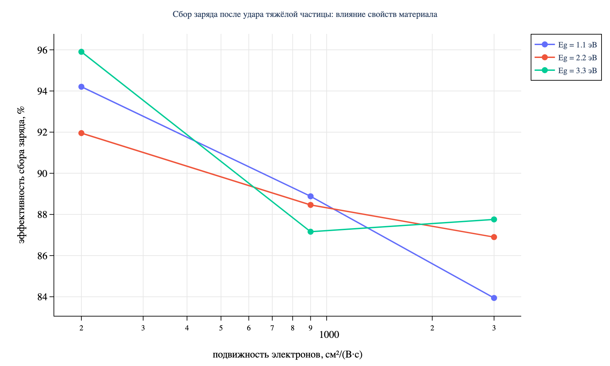

**Эффективность сбора, %**

| | µ=200 | µ=900 | µ=3000 | разброс |
|---|---|---|---|---|
| E<sub>g</sub> = 1.1 эВ | 94.2 | 88.9 | 83.9 | 10.3 п.п. |
| E<sub>g</sub> = 2.2 эВ | 92.0 | 88.5 | 86.9 | 5.1 п.п. |
| E<sub>g</sub> = 3.3 эВ | 95.9 | 87.2 | 87.8 | 8.7 п.п. |

**Собранный заряд, пКл**

| | µ=200 | µ=900 | µ=3000 |
|---|---|---|---|
| E<sub>g</sub> = 1.1 эВ | 0.1913 | 0.1805 | 0.1704 |
| E<sub>g</sub> = 2.2 эВ | 0.1016 | 0.0978 | 0.0961 |
| E<sub>g</sub> = 3.3 эВ | 0.0728 | 0.0662 | 0.0666 |

**Что делают два параметра.** Они действуют на **разные наблюдаемые**, и это
главный результат:

- **Ширина зоны задаёт абсолютный сигнал.** Собранный заряд падает в 2.73 раза
  от 1.1 до 3.3 эВ, почти целиком через правило Кляйна. Эффективность почти не
  меняется.
- **Подвижность задаёт эффективность.** Пять–десять процентных пунктов на
  пятнадцатикратном диапазоне подвижности, при любой ширине зоны. Абсолютный
  заряд почти не меняется.

Если подгонять параметры под измеренную *высоту* импульса, точно знать надо
ширину зоны. Если под собранную *долю* — подвижность. Усилия на не тот параметр
уходят впустую.

**Контринтуитивная часть.** Эффективность сбора **падает** с ростом
подвижности. Наивно ждёшь обратного: быстрые носители должны успеть уйти до
рекомбинации.

Установленного механизма у меня нет. Главный кандидат — диффузионное
расплывание. Коэффициент диффузии следует за подвижностью по соотношению
Эйнштейна, D = µkT/q, так что в пятнадцать раз большая подвижность — это в
пятнадцать раз большая диффузия. Плазма трека расползается вбок как √(4Dt), и
при аноде в 1 мкм на приборе шириной 3 мкм большая доля носителей уходит из
области сбора и рекомбинирует.

Гипотеза дёшево проверяется: расширить анод на всю грань — эффект должен
уменьшиться. Здесь не сделано.

### Часть, которая на самом деле стоила дня

Одна точка сетки — E<sub>g</sub> = 3.3 эВ, µ = 200, угол, где плазма живёт дольше всего
и вытягивается медленнее всего, — дала **четыре разных ответа** при четырёх
схемах интегрирования:

| схема | результат | что было не так | файлы |
|---|---|---|---|
| окно 1 нс, шаг 20 пс | 70.7% | хвост обрезан: на краю окна ещё течёт 33% пикового тока | [m20.cmd](experiments/heavy_ion/sweep/m20.cmd) |
| окно 40 нс, шаг 400 пс | 98.8% | инжекция не разрешена: удар длится пикосекунды, шаг 400 пс через него перешагивает | [Lm20.cmd](experiments/heavy_ion/sweep/Lm20.cmd) |
| две стадии, вторая грубая | 1671% | решатель прервался — *«Step is too small»*, — оставив частичный, бессмысленный интеграл | [Tm20.cmd](experiments/heavy_ion/sweep/Tm20.cmd) |
| две стадии, вторая мелкая | **95.9%** | остаточный ток 1.8·10<sup>−14</sup> от пика, интеграл полный | [Sm20.cmd](experiments/heavy_ion/sweep/Sm20.cmd) |

Правильное значение — 95.9%, и это делает угол *лучшей* точкой карты. Первая
попытка показывала его худшей с большим отрывом.

Из этого следуют две вещи.

**Схема интегрирования может перевесить то, что измеряешь.** Разброс между
четырьмя артефактами больше, чем разброс между многими опубликованными
наборами параметров реальных материалов. Сравнение материалов на одной
фиксированной схеме по времени может оказаться сравнением схемы, а не
материалов.

**Цена правильного ответа неодинакова по пространству параметров.** Восемь из
девяти точек сошлись на первой схеме. Девятой понадобилось четыре попытки — и
это не случайная точка, а физически самый жёсткий угол. Развёртки на
одинаковых настройках поэтому систематически менее точны именно там, где
физика интереснее всего.

Ни одно из наблюдений не глубокое. Но на оба легко попасться: первый
артефакт дал седловидную карту с переворотом тренда, которая выглядела как
находка. А это был обрезанный хвост.

**Проверка, которая это ловит.** Дёшево и достаточно: для каждого прогона
показывать остаточный ток в конце окна в долях пикового.

```
          µ=200      µ=900     µ=3000
Eg=1.1    1.4e-05    1.2e-12   4.0e-13
Eg=2.2    5.1e-07    2.2e-14   3.0e-15
Eg=3.3    3.3e-01 ←  9.6e-15   1.9e-16
```

Единственное плохое число бросается в глаза сразу. Две точки дополнительно
пересчитаны с окном в шестьдесят раз длиннее и воспроизвели прежние значения до
десятой доли процента — это и делает остальную таблицу надёжной.

### Ограничения

Прямо, потому что они не маленькие:

- **Сетка параметров 3×3.** Хватает для трендов, не для поверхности отклика.
- **Параметры менялись независимо.** В реальных материалах ширина зоны,
  диэлектрическая проницаемость и подвижность связаны; некоторые из этих
  сочетаний не могут существовать.
- **Диапазоны выбраны руками**, а не взяты из разброса по литературе.
- **Подвижность дырок взята как треть подвижности электронов** без
  обоснования, кроме правдоподобия.
- **Одна геометрия.** Эффект подвижности, скорее всего, связан с частичным
  анодом, так что на другой прибор ничего не переносится без проверки.
- **Нет экспериментальной проверки**, и в такой постановке её не может быть.

Это пилот, а не результат, на котором можно строить.

### Воспроизводимость

Всё запускается из блокнота Jupyter на маке; решатель работает в виртуалке и
управляется через сетевой шелл. Вся развёртка из девяти точек — меньше часа
счёта без присмотра.

Сам решатель быстрый: две итерации Ньютона на шаг по времени, по 0.13 с каждая,
на этой сетке. Длинные прогоны дёшевы, если не давать им умирать — а это, как
описано в первой заметке, было отдельной проблемой.

Файлы развёртки — [experiments/heavy_ion/sweep/](experiments/heavy_ion/sweep/):

| | |
|---|---|
| [runs.json](experiments/heavy_ion/sweep/runs.json) | план: метка точки, E<sub>g</sub>, µ, пересчитанный `LET_f` |
| `m00.cmd` … `m22.cmd`, `m00.par` … `m22.par` | девять точек: задание решателя и подмена параметров материала (метка `mXY`: X — номер E<sub>g</sub>, Y — номер µ) |
| `Lm*.cmd`, `Tm*.cmd`, [Sm20.cmd](experiments/heavy_ion/sweep/Sm20.cmd) | длинное окно, две стадии с грубой и с мелкой второй стадией |
| `i_m*.plt`, `Lm*.plt`, `Tm*.plt`, `Sm20.plt` | токи во времени |
| [results.json](experiments/heavy_ion/sweep/results.json), [results_two.json](experiments/heavy_ion/sweep/results_two.json), [final.json](experiments/heavy_ion/sweep/final.json) | собранный заряд, эффективность, пик, остаточный ток |
| [runall.bat](experiments/heavy_ion/sweep/runall.bat), [runlong.bat](experiments/heavy_ion/sweep/runlong.bat), [runtwo.bat](experiments/heavy_ion/sweep/runtwo.bat), [runs4.bat](experiments/heavy_ion/sweep/runs4.bat) | батники для запуска через `at` |

Сетка во всех прогонах — 2D-диод 3 × 1 мкм (`sh1_msh.grd` + `sh1_msh.dat`,
162 узла), собранный как в лабе 1. Сам файл сетки остался внутри виртуалки и
сюда не выгружен; чтобы повторить, его надо построить из
[Lab1_diode_2D/ise/sh1.bnd](Lab1_diode_2D/ise/sh1.bnd) и
[sh1.cmd](Lab1_diode_2D/ise/sh1.cmd) с толщиной 1 мкм.

### Стоит ли продолжать

Как исследование — нет. Находки тонкие, механизм не объяснён, а методические
наблюдения — проверяй окно интегрирования, проверяй шаг — это уроки, а не
открытия.

Как упражнение — стоило. Стенд работает, конвейер переиспользуется, а
решатель, которому уже можно голосовать, вполне способен давать количественно
верную физику — если аккуратно обращаться с единицами, со временем и с
собственными допущениями.

---

## Установка окружения

Python через conda, всё в одном окружении:

```bash
conda env create -f environment.yml
conda activate nanomod
jupyter lab
```

Состав и версии — в [environment.yml](environment.yml). `devsim` и `gmsh`
нужны только для [Lab3_diode_3D/devsim](Lab3_diode_3D/devsim/run.py), остальному
хватает numpy, scipy, matplotlib, plotly.

Для самих расчётов в ISE дополнительно нужны (на маке):

- [UTM](https://mac.getutm.app) — виртуалка, эмуляция x86 (i386) для Windows XP SP3,
  с включённым PS/2 (`PS2Controller`);
- своя копия ISE TCAD 7.0 с X-сервером и Cygwin из её комплекта;
- Telnet Server в XP, настроенный как описано выше.

---

## Ссылки

- Оригиналы заметок (на английском): [ISE TCAD 7.0 on Apple Silicon](https://libretimes.io/works/01a063b5-d966-7030-966d-42660150d2cb),
  [Charge Collection After Heavy-Ion Strikes](https://libretimes.io/works/01a066e7-2b5f-7a90-920a-37bd689a22f1)
- [UTM issue #3723](https://github.com/utmapp/UTM/issues/3723) — Windows XP виснет на установке без PS/2
- [DEVSIM](https://devsim.org) — открытый TCAD-решатель на Python
- [Gmsh](https://gmsh.info) — генератор сеток
- Соседний курсовой репозиторий в том же духе: [Cluster_Computing_Course_MIPT_2021](https://github.com/alexlegoshin/Cluster_Computing_Course_MIPT_2021)
